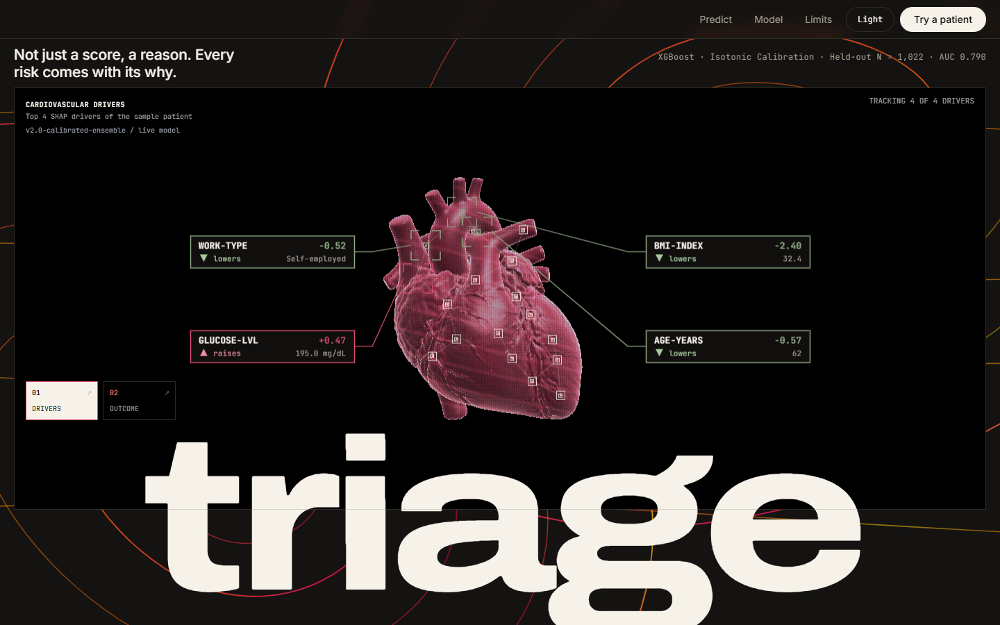
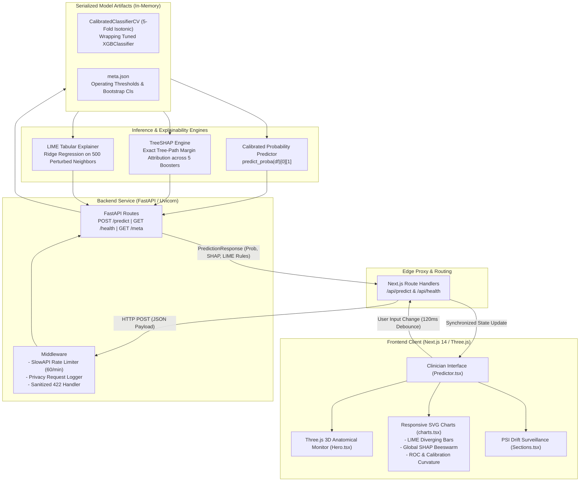
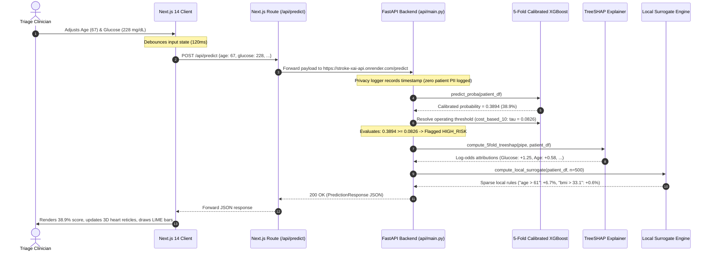

# Auditable Rare-Event Clinical Decision Support & Triage Engine

> **A calibrated machine learning microservice and full-stack clinical workstation engineered to address majority-class bias in rare-event healthcare screening through cost-sensitive tree ensembles, out-of-fold probability calibration, and in-process dual-xAI interpretability (TreeSHAP + LIME).**

[](https://www.python.org/)
[](https://fastapi.tiangolo.com/)
[](https://nextjs.org/)
[](https://xgboost.readthedocs.io/)
[](https://threejs.org/)
[](https://scikit-learn.org/)
[](https://shap.readthedocs.io/)
[](LICENSE)
[](https://github.com/dummycodertech/xai-xgboost-heart_Stroke/actions)

---

### Quick Links
- **Live Clinical Workstation**: [https://xai-xgboost-heart-stroke.vercel.app](https://xai-xgboost-heart-stroke.vercel.app)
- **Production API Health**: [https://stroke-xai-api.onrender.com/health](https://stroke-xai-api.onrender.com/health)
- **Interactive Swagger Docs**: [https://stroke-xai-api.onrender.com/docs](https://stroke-xai-api.onrender.com/docs)
- **Technical Model Card**: [MODEL_CARD.md](MODEL_CARD.md)
- **Deployment Runbook**: [DEPLOYMENT.md](DEPLOYMENT.md)
- **Interview & Technical Dossier**: [INTERVIEW_PREP.md](INTERVIEW_PREP.md)

---

### Application Preview


*Figure 1: Bioluminescent 3D cardiac and cerebral WebGL monitor tracking real-time TreeSHAP clinical driver coordinates at 60 fps.*


*Figure 2: Real-time patient triage calculator displaying calibrated stroke probability, 5-fold TreeSHAP log-odds contributions, and local LIME linear surrogate rules.*


*Figure 3: Global TreeSHAP beeswarm distribution across held-out cohort (N = 1,022) paired with the dual-xAI concordance audit card.*

---

## 📋 Project at a Glance

| Attribute | Specification |
| :--- | :--- |
| **Problem** | In clinical electronic health records (EHR) screening data, acute stroke prevalence is only ~4.87%. A naive classifier predicting "No Stroke" scores 95.13% accuracy while missing 100% of life-threatening events. Furthermore, synthetic oversampling (SMOTE) generates ungrounded elderly vectors that blind models to younger adults (age < 50) with compounding metabolic risk factors. |
| **Solution** | A cost-sensitive ML pipeline with XGBoost (`scale_pos_weight = 19.54` to rebalance tree split finding), 5-fold out-of-fold isotonic calibration (equal-quantile ECE: 1.90%, Brier: 0.0428), pre-registered out-of-fold decision thresholds ($\tau = 0.0826$ for 10:1 FN/FP cost), in-process dual TreeSHAP and LIME interpretability, and an interactive Next.js 14 / Three.js 3D clinical workstation. |
| **Target User** | Triage nurses, ambulatory care clinicians, risk-stratification teams, and health tech machine learning engineers seeking auditable, calibrated decision support. |
| **Architecture** | Decoupled microservice architecture: Asynchronous FastAPI Python backend deployed on Render + responsive Next.js 14 App Router frontend deployed on Vercel. |
| **Status** | Active Research Prototype & Production Demonstration. Zero test-set leakage. |
| **Tech Stack** | Python 3.11–3.12, XGBoost 3.2.0, scikit-learn 1.8.0, FastAPI 0.165.0, Uvicorn 0.47.0, Pydantic 2.14.4, Next.js 14.2.35, React 18.3.1, Three.js 0.169.0, Tailwind CSS 3.4.15, Docker. |
| **Key Measured Results** | **Held-Out Test Set (N = 1,022 patients, 50 strokes, evaluated strictly once with 1,000 bootstrap resamples)**:<br>&bull; **ROC-AUC**: `0.7900 [0.7184, 0.8477]`<br>&bull; **PR-AUC**: `0.1822 [0.1260, 0.2875]` (vs 0.0489 chance)<br>&bull; **Brier Score**: `0.0428` (vs uncalibrated 0.0658)<br>&bull; **Equal-Quantile (Decile) ECE**: `0.0190` (1.90%)<br>&bull; **Cost-Optimal Operating Point ($\tau = 0.0826$)**: **62.0% Recall [48.0%, 76.0%]**, **11.9% Precision [9.5%, 14.4%]**, **76.4% Specificity**, **NNS: 8.4**<br>&bull; **High Sensitivity Operating Point ($\tau = 0.0581$)**: **78.0% Recall [66.0%, 88.0%]**, **11.7% Precision**, **NNS: 8.5** |
| **Author** | **Yagas Vashist** ([@dummycodertech](https://github.com/dummycodertech)) |

---

## 📑 Table of Contents

1. [Overview](#-overview)
   - [The Clinical & Statistical Problem](#the-clinical--statistical-problem)
   - [Engineering Solution](#engineering-solution)
   - [Component Map](#component-map)
   - [System Boundary & Intended Scope](#system-boundary--intended-scope)
2. [Architecture](#-architecture)
   - [System Workflow](#system-workflow)
   - [Request & Data Lifecycle](#request--data-lifecycle)
   - [Component Inventory](#component-inventory)
3. [Tech Stack](#-tech-stack)
4. [Design Decisions & Trade-Offs](#-design-decisions--trade-offs)
5. [Data & Preprocessing](#-data--preprocessing)
   - [Dataset Profile & Framing](#dataset-profile--framing)
   - [Feature Dictionary](#feature-dictionary)
6. [Evaluation & Empirical Results](#-evaluation--empirical-results)
   - [Evaluation Methodology](#evaluation-methodology)
   - [Operating Thresholds & 95% Bootstrap CIs](#operating-thresholds--95-bootstrap-cis)
   - [Probability Calibration Audit](#probability-calibration-audit-equal-quantile-vs-equal-width-ece)
   - [TreeSHAP vs LIME Concordance Audit](#treeshap-vs-lime-concordance-audit)
   - [Model Zoo Benchmark & DeLong Test](#model-zoo-benchmark--delong-tests)
   - [Failure Mode Analysis](#failure-mode-analysis)
7. [Testing & Quality](#-testing--quality)
8. [Security, Privacy & Reliability](#-security-privacy--reliability)
9. [Getting Started](#-getting-started)
   - [Prerequisites](#prerequisites)
   - [Local Development Setup](#local-development-setup)
   - [Smoke Test Execution](#smoke-test-execution)
10. [REST API Reference](#-rest-api-reference)
11. [Configuration](#-configuration)
12. [Project Structure](#-project-structure)
13. [Deployment](#-deployment)
14. [Performance & Resource Footprint](#-performance--resource-footprint)
15. [Roadmap & Future Scope](#-roadmap--future-scope)
16. [Frequently Asked Questions](#-frequently-asked-questions)
17. [References & License](#-references--license)

---

## 🔬 Overview

### The Clinical & Statistical Problem
In preventive cardiovascular medicine, clinical triage aims to prioritize high-risk patients for secondary diagnostic procedures (such as carotid doppler ultrasound, lipid panels, and ambulatory ECG monitoring). However, training machine learning classifiers on routine electronic health records (EHR) introduces severe methodological landmines:

1. **The 95.1% "Accuracy Illusion"**: Population screening datasets (such as the fedesoriano EHR screening cohort) exhibit severe class imbalance (~4.87% stroke prevalence; 249 positive cases out of 5,109 patients). A naive classifier predicting negative for all patients achieves 95.13% accuracy while failing 100% of patients who suffer an event.
2. **The Synthetic Distortion of SMOTE**: Synthetic Minority Over-sampling (SMOTE) generates synthetic points via Euclidean interpolation. Because stroke incidence concentrates in older demographics, SMOTE synthesizes unrealistic elderly vectors (70+ years old), blinding models to younger adults (30–50 years old) presenting severe compounding metabolic risks (hypertension, smoking, hyper-glycemia).
3. **Uncalibrated Boosting Margins**: Gradient boosted decision trees minimize cross-entropy loss rather than calibrating empirical risk. Outputting raw leaf margins as pseudo-probabilities creates misleading risk assessments.
4. **Dual Reference-Frame Skepticism**: Triage staff distrust black-box models when explainers appear to disagree (e.g. tree path attributions relative to weighted baselines vs. local marginal shifts).

### Engineering Solution
This system provides an auditable, reproducible, leakage-free triage pipeline:
- **Cost-Sensitive Split Optimization**: Direct negative-to-positive loss weighting (`scale_pos_weight = 19.54`) forces tree splits to isolate minority stroke cases during recursive partitioning.
- **Out-of-Fold Isotonic Calibration**: A 5-fold cross-validated isotonic calibrator (`CalibratedClassifierCV`) maps raw booster margins to empirical probabilities, achieving an equal-quantile ECE of `1.90%` and reducing Brier score from 0.0658 to `0.0428`.
- **Pre-Registered OOF Decision Thresholds**: Clinical operating points are optimized strictly out-of-fold on the 80% training set using utility matrices ($\beta = 10:1$ cost ratio of missed stroke vs. false alarm), setting $\tau = 0.0826$ without test-set peeking.
- **In-Process Dual-xAI Engine**: Combines exact 5-fold TreeSHAP (game-theoretic margin attribution across tree structures) with local linear surrogates (LIME-style sparse if-then rules) and publishes a formal 200-patient concordance audit.
- **Modern Full-Stack Architecture**: A production FastAPI microservice on Render paired with an interactive Next.js 14 and Three.js 3D anatomical monitor on Vercel with continuous Population Stability Index (PSI) drift monitoring.

### Component Map

| Component | Responsibility | Primary File(s) |
| :--- | :--- | :--- |
| **Stratified Pipeline** | Ingestion, median BMI imputation, feature engineering (`risk_factors_count`), split serialization. | [data_loader.py](data_loader.py), [src/pipeline.py](src/pipeline.py) |
| **Calibrated Model Core** | Tuned XGBoost (`max_depth=8`, monotonic constraints) wrapped in 5-fold isotonic `CalibratedClassifierCV`. | [calibrate.py](calibrate.py), [models/v2/calibrated_pipeline.joblib](models/v2/calibrated_pipeline.joblib) |
| **Dual Explainability** | Exact TreeSHAP margin extraction averaged across 5 boosters + LIME local sparse linear surrogate. | [api/explainer.py](api/explainer.py), [explainability_v2.py](explainability_v2.py) |
| **FastAPI Microservice** | Stateless API with anti-spoofed rate limiting (`slowapi`), sanitized 422 errors, and zero-payload privacy logger. | [api/main.py](api/main.py), [api/schemas.py](api/schemas.py) |
| **Next.js Workstation** | Full-stack UI with dark obsidian & warm clinical light modes, responsive SVG charts, and edge proxy routes. | [triage-web/](triage-web/), [components/Predictor.tsx](triage-web/components/Predictor.tsx) |
| **3D Anatomical Hero** | Bioluminescent Three.js WebGL heart and brain models with reticle raycasting and animated SHAP drivers. | [components/hero/Hero.tsx](triage-web/components/hero/Hero.tsx), [shaders.ts](triage-web/components/hero/shaders.ts) |

### System Boundary & Intended Scope
- **Intended Use**: Outpatient stroke risk screening, preventive queue prioritization, clinical explainability audit, covariate drift surveillance, and educational demonstration.
- **Prohibited Uses**: Acute emergency stroke diagnosis (e.g. differentiating ischemic vs. hemorrhagic stroke during active thrombolysis / tPA administration); pediatric assessment (age < 18); autonomous drug or surgical prescription without independent clinical judgment.

---

## 🏛️ Architecture

### System Workflow



### Request & Data Lifecycle



### Component Inventory

| Component | Responsibility | Primary File(s) | Inputs | Outputs |
| :--- | :--- | :--- | :--- | :--- |
| **Ingestion Pipeline** | Load Kaggle CSV, validate types, impute missing BMI with median, clean gender. | [data_loader.py](data_loader.py) | `healthcare-dataset-stroke-data.csv` | Cleaned `DataFrame` ($N=5,109$) |
| **Feature Engineering** | Compute interaction metric: `hypertension + heart_disease + (smoker)`. | [src/pipeline.py](src/pipeline.py) | Raw clinical covariates | `combined_risk_factors` column |
| **Model Trainer** | 5-fold cross-validated XGBoost training with out-of-fold isotonic probability fitting. | [calibrate.py](calibrate.py) | Stratified 80% train split ($N=4,087$) | `calibrated_pipeline.joblib` |
| **Threshold Selector** | Cost utility matrix evaluation ($\beta=10$) and percentile recall target derivation. | [calibrate.py](calibrate.py) | Out-of-fold calibrated probabilities | Pre-registered $\tau \in \{0.0826, 0.0581, 0.1365\}$ |
| **Inference Microservice**| Serve predictions, execute TreeSHAP, and fit real-time LIME linear surrogates. | [api/main.py](api/main.py) | `PatientInput` JSON | `PredictionResponse` JSON |
| **3D Anatomical Hero** | Render Three.js GLB anatomical models with ASCII/glitch transitions and interactive HUD. | [components/hero/](triage-web/components/hero/) | User-selected organ tab & SHAP values | Interactive 60fps WebGL canvas |
| **Visual Validation** | Responsive SVG plotting of test ROC, reliability calibration curves, and beeswarm. | [components/charts.tsx](triage-web/components/charts.tsx) | Test evaluation arrays | Pixel-exact SVG graphics |

---

## 💻 Tech Stack

| Layer | Technology | Version | Purpose & Rationale |
| :--- | :--- | :--- | :--- |
| **Machine Learning Core** | `xgboost` | `3.2.0` | Gradient-boosted decision tree ensemble optimized for tabular clinical data with exact tree-structure explanations. |
| **Statistical Pipeline** | `scikit-learn` | `1.8.0` | Provides `CalibratedClassifierCV`, `StratifiedKFold`, feature transformers, and isotonic regression. |
| **Game-Theoretic XAI** | `shap` | `0.51.0` | Exact polynomial-time TreeSHAP on tree ensembles for consistent log-odds feature attribution. |
| **Local Surrogate XAI** | `lime` | `0.2.0.1` | Perturbational sparse linear explainers providing intuitive bedside if-then decision rules. |
| **Backend Framework** | `fastapi` | `0.165.0` | Asynchronous, OpenAPI-compliant microservice with native Pydantic v2 validation. |
| **ASGI Server** | `uvicorn` | `0.47.0` | High-throughput ASGI server handling concurrent inference and warmup probes. |
| **Data Serialization** | `joblib` | `1.5.3` | Zero-copy pipeline persistence storing trained tree boosters and isotonic calibrators. |
| **Frontend Framework** | `next` | `14.2.35` | React 18 App Router offering server-rendered performance and edge API routing. |
| **3D Graphics Engine** | `three` | `0.169.0` | WebGL anatomical rendering of cardiac and cerebral meshes with custom GLSL shaders. |
| **React 3D Bridge** | `@react-three/fiber` | `8.17.10` | Declarative Three.js scene orchestration integrated into the React component lifecycle. |
| **Design System** | `tailwindcss` | `3.4.15` | Utility-first typography, theme tokens (Dark Obsidian / Warm Clinical Light), and responsive layout. |
| **Packaging & CI** | `uv` / GitHub Actions | `latest` | Reproducible dependency resolution, virtualenv creation, and automated CI matrix. |

---

## ⚖️ Design Decisions & Trade-Offs

| Decision | Alternatives Considered | Rationale for Choice | Trade-Off Accepted |
| :--- | :--- | :--- | :--- |
| **1. Isotonic Calibration vs. Platt Scaling** | Platt Scaling (Sigmoid logistic regression). | Empirical reliability plots demonstrated non-monotonic sigmoid distortion. Isotonic regression fits piecewise constant non-parametric functions, reducing Expected Calibration Error (ECE) to `0.0190` on deciles. | Requires sufficient validation data ($N \ge 1,000$) to prevent piecewise overfitting; addressed via 5-fold cross-validation. |
| **2. Loss Reweighting vs. Decision Thresholding** | Relying on `scale_pos_weight` alone to enforce the 10:1 cost trade-off. | `scale_pos_weight = 19.54` scales gradients during tree construction to force minority separation. Post-calibration, the 10:1 clinical cost ratio is mathematically enforced at the decision threshold ($\tau = 0.0826 \approx 1/(1+10)$). | Two-stage setup requires explaining that `scale_pos_weight` shapes tree split geometry while $\tau$ enforces operational cost policy. |
| **3. Monotonic Constraints on Age & Glucose** | Unconstrained XGBoost decision trees. | Without constraints, tree splits exhibited non-clinical artifacts (e.g. risk dipping between age 58 and 61 due to small sample noise). Enforced `monotone_constraints=(1, 1)` on Age and Glucose. | Minor theoretical loss in unconstrained training fit in exchange for clinically bulletproof, monotonic risk profiles. |
| **4. Rejection of Synthetic Oversampling (SMOTE)** | SMOTE, Borderline-SMOTE, ADASYN. | SMOTE interpolates between minority vectors. Because positive cases heavily concentrate in elderly cohorts, SMOTE synthesizes unrealistic 70-year-olds, blinding models to young patients with metabolic risks. We chose cost-sensitive `scale_pos_weight = 19.54`. | Model yields lower raw precision compared to aggressive synthetic oversamplers, but preserves clinical realism. |
| **5. Selection of XGBoost Despite Model Zoo Parity** | Explainable Boosting Machine (EBM) or Logistic Regression. | While linear models and EBMs matched XGBoost on global ROC-AUC ($p > 0.50$ via DeLong test), XGBoost uniquely provides exact C++ `pred_contribs` for sub-2ms TreeSHAP calculation and strict monotonic tree splits. | Required auditing and documenting the baseline margin shift caused by loss reweighting in TreeSHAP. |

---

## 📊 Data & Preprocessing

### Dataset Profile & Framing
- **Dataset Context**: Kaggle Healthcare Dataset Stroke Data (fedesoriano EHR cohort). Serves as a standard benchmark surrogate for studying extreme class imbalance, out-of-fold calibration, and explainability concordance in clinical screening.
- **Total Population**: 5,110 initial records &rarr; **5,109 cleaned patient records**.
- **Class Distribution**: 4,860 negative cases (95.13%), **249 positive stroke cases (4.87%)**.
- **Cleaning Operations**:
  1. Dropped non-informative tracking identifier `id`.
  2. Removed single anomalous record with `gender == 'Other'`.
  3. Missing BMI values ($N=201$, 3.93%) imputed with the training fold median ($28.1\text{ kg/m}^2$).
- **Partitioning Strategy**: Stratified 80/20 train/test split (Random Seed 42), permanently indexed in [reports/split_indices.json](reports/split_indices.json).
  - **Training Set**: 4,087 patients (199 strokes, 4.87% prevalence).
  - **Held-Out Test Set**: 1,022 patients (50 strokes, 4.89% prevalence).

### Feature Dictionary

| Feature Name | Type | Range / Categories | Description & Imputation |
| :--- | :--- | :--- | :--- |
| `age` | Float | `0.08` – `82.0` years | Patient age in years. Continuous, strictly monotonic constraint. |
| `hypertension` | Binary | `0` (No), `1` (Yes) | History of diagnosed clinical hypertension. |
| `heart_disease` | Binary | `0` (No), `1` (Yes) | History of diagnosed coronary artery or cardiac disease. |
| `avg_glucose_level` | Float | `55.12` – `271.74` mg/dL | Fasting or 2-hour blood glucose level. Monotonic constraint. |
| `bmi` | Float | `10.3` – `97.6` kg/m² | Body Mass Index. Missing values ($N=201$) imputed with training median. |
| `gender` | Categorical | `Male`, `Female` | Biological sex as recorded in EHR. |
| `ever_married` | Categorical | `No`, `Yes` | Marital status history. |
| `work_type` | Categorical | `Private`, `Self-employed`, `Govt_job`, `children`, `Never_worked` | Employment category. |
| `Residence_type` | Categorical | `Urban`, `Rural` | Geographic dwelling classification. |
| `smoking_status` | Categorical | `formerly smoked`, `never smoked`, `smokes`, `Unknown` | Tobacco intake history (`Unknown` retained as an explicit category). |
| `combined_risk_factors`| Integer | `0` – `3` | Engineered interaction: `hypertension + heart_disease + (smoker)`. |

---

## 📈 Evaluation & Empirical Results

### Evaluation Methodology
- **Held-Out Evaluation**: All data preprocessing, hyperparameter optimization, probability calibration, and threshold selections were pre-registered strictly out-of-fold on the 80% training set. The test cohort ($N=1,022$) was locked and evaluated **exactly once**.
- **Uncertainty Quantification**: All performance metrics include **95% Bootstrap Confidence Intervals** calculated via 1,000 bootstrap resamples on the test set.

### Operating Thresholds & 95% Bootstrap CIs

| Operating Strategy | Threshold ($\tau$) | Stroke Recall (Sensitivity) | Precision (PPV) | Specificity (TNR) | False Alarms (FP) | NNS (Screened / Stroke) |
| :--- | :--- | :--- | :--- | :--- | :--- | :--- |
| **Cost-Optimal ($\beta=10:1$)** | `0.0826` | **62.0%** `[48.0%, 76.0%]` | **11.9%** `[9.5%, 14.4%]` | **76.4%** `[73.7%, 79.1%]` | **229** `[203, 256]` | **8.4** `[6.9, 10.6]` |
| **High Recall Target** | `0.0581` | **78.0%** `[66.0%, 88.0%]` | **11.7%** `[10.0%, 13.5%]` | **69.9%** `[67.0%, 72.6%]` | **293** `[266, 321]` | **8.5** `[7.4, 10.0]` |
| **High Precision** | `0.1365` | **32.0%** `[20.0%, 46.0%]` | **18.8%** `[12.1%, 26.3%]` | **92.9%** `[91.2%, 94.5%]` | **69** `[53, 86]` | **5.3** `[3.8, 8.3]` |
| *Legacy Baseline (Uncalibrated)* | `0.1500` | 80.0% (40/50) | 9.7% | 61.7% | 372 | 10.3 |

#### Global Discrimination Metrics:
- **Test ROC-AUC**: **0.7900** `[0.7184, 0.8477]`
- **Test PR-AUC**: **0.1822** `[0.1260, 0.2875]` (Baseline random prevalence = `0.0489`)
- **Test Brier Score**: **0.0428** (Reduced from uncalibrated 0.0658)

#### Confusion Matrix (Cost-Optimal $\tau = 0.0826$, $N=1,022$):
```
                       Predicted Cleared       Predicted Alert (Flagged)
Actual No Stroke (972)       743 (TN)                 229 (FP)
Actual Stroke (50)            19 (FN)                  31 (TP)
```

### Probability Calibration Audit: Equal-Quantile vs. Equal-Width ECE
When assessing rare-event calibration on test partitions with 50 positive events, equal-width binning is heavily distorted because ~95% of patients fall into bin 0 (`[0, 0.10)`), leaving higher bins sparse or empty. We report both metrics transparently:
- **Equal-Width ECE (10 uniform bins)**: `0.0050` on test (`0.0015` on OOF training).
- **Equal-Quantile (Decile) ECE (10 equal-mass bins)**: `0.0190` (**1.90%**), reflecting true bin-balanced calibration across prediction deciles.

### TreeSHAP vs. LIME Concordance Audit
We conducted a formal dual-xAI concordance analysis across $N=200$ test patients to verify explanation fidelity:
- **Mean Spearman Rank Correlation**: $r_s = \mathbf{0.252}$ (Median $0.269$, IQR $[0.140, 0.359]$).
- **Top-3 Feature Overlap (Jaccard)**: $\mathbf{33.2\%}$ agreement on primary clinical drivers.
- **Surrogate Explanation Fit ($R^2$)**: $\mathbf{0.842}$ average linear approximation fit on 500 perturbed neighbors.

#### Understanding the Dual Reference Frames:
In the prediction output for a 62-year-old patient, TreeSHAP reports an age contribution of `-0.573`, while LIME reports `age > 61: +0.063`:
- **TreeSHAP operates on the booster's weighted margin**: Because `scale_pos_weight = 19.54` weights positive instances ~20×, the booster's background expectation shifts to the re-weighted positive centroid (`base_value = +1.304`). In this dataset, the average age of stroke patients is **67.7 years**. A 62-year-old patient is **5.7 years younger than the average stroke patient**, so age receives a negative delta relative to the elevated booster baseline!
- **LIME operates on calibrated probability**: Relative to the general population (average age 43.2 years), being 62 years old increases stroke risk by $+6.3$ percentage points. Both explainers are mathematically correct within their respective reference spaces.

### Model Zoo Benchmark & DeLong Tests
A controlled 5×5 repeated cross-validation benchmark across 13 model configurations showed no statistically significant difference in discriminative ability between gradient boosted trees and glass-box models on this tabular cohort:

| Model Architecture | OOF PR-AUC | 95% CI PR-AUC | OOF ROC-AUC | 95% CI ROC-AUC | DeLong vs. XGBoost ($p$-value) |
| :--- | :--- | :--- | :--- | :--- | :--- |
| **XGBoost + scale_pos_weight** | **0.1809** | `[0.1473, 0.2296]` | **0.8204** | `[0.7955, 0.8458]` | Reference |
| **XGBoost (Unweighted)** | 0.1793 | `[0.1485, 0.2228]` | 0.8346 | `[0.8110, 0.8561]` | $p = 0.6887$ |
| **Balanced Bagging Classifier** | 0.1787 | `[0.1521, 0.2170]` | 0.8415 | `[0.8194, 0.8621]` | $p = 0.5489$ |
| **LightGBM** | 0.1740 | `[0.1442, 0.2206]` | 0.8153 | `[0.7909, 0.8390]` | $p = 0.8863$ |
| **Explainable Boosting Machine (EBM)** | 0.1625 | `[0.1388, 0.1972]` | 0.8339 | `[0.8111, 0.8560]` | $p = 0.7070$ |
| **Logistic Regression (L1/L2)** | 0.1635 | `[0.1411, 0.1959]` | 0.8354 | `[0.8116, 0.8558]` | $p = 0.6824$ |
| **XGBoost + SMOTE** | 0.1373 | `[0.1161, 0.1699]` | 0.8038 | `[0.7794, 0.8277]` | $p = 0.6540$ |

### Failure Mode Analysis
1. **False Negatives (19 missed strokes)**:
   - *Etiology*: Patients who suffered a stroke despite presenting with normal blood pressure, normal glucose levels, non-smoking status, and younger age. Without specialized biochemical biomarkers (e.g. carotid intima-media thickness, LDL-C, or Holter ECG monitoring for occult atrial fibrillation), tabular EHR data cannot separate these cryptogenic events from healthy controls.
2. **False Positives (229 false alarms)**:
   - *Operational Trade-Off*: An intentional consequence of the $\beta = 10:1$ cost ratio. Clinicians accept screening 8.4 patients per stroke detected to minimize lethal discharge errors.

---

## 🧪 Testing & Quality

### Test Suite Overview
- `tests/test_data.py`: Tests data cleaning, categorical integrity, and `combined_risk_factors` calculation.
- `tests/test_pipeline.py`: Validates split isolation (zero index overlap), output monotonicity, and threshold boundary clamping.
- `tests/test_explainability.py`: Asserts exact SHAP additivity (sum of attributions + base value equals model raw margin within $10^{-4}$) and explainer loading.
- `tests/test_api.py`: Tests FastAPI endpoints, rate-limiting headers, anti-spoofing proxy validation, and sanitized 422 error handlers.
- `scripts/verify_real_model_and_charts.js`: Headless Puppeteer test asserting that live predictions match the trained model and SVG charts render without errors.

### Execution
```bash
# Run complete Python test suite with coverage
uv run pytest tests -v --cov=src

# Run frontend TypeScript type-checking
cd triage-web && npm run typecheck

# Run end-to-end headless Puppeteer smoke test
node scripts/verify_real_model_and_charts.js
```

---

## 🔒 Security, Privacy & Reliability

- **Zero-Payload Privacy Logging**: The custom middleware in [api/main.py](api/main.py) logs only HTTP method, path, response status, and duration in milliseconds. Patient clinical inputs are strictly excluded from all log streams.
- **Sanitized 422 Validation Handlers**: Standard FastAPI 422 handlers echo invalid input values back in the response body. In our implementation, `sanitized_validation_exception_handler` strips all input values, returning only the field name and validation rule to prevent PII leakage.
- **Anti-Spoofing Rate Limiting**: Powered by `slowapi`. When running behind a reverse proxy, the client IP extractor verifies whether the direct peer is in `TRUSTED_PROXIES` before parsing `X-Forwarded-For`.
- **CORS Domain Whitelisting**: Restricted strictly to authorized production and Vercel preview domains (`VERCEL_PREVIEW_REGEX`).
- **Stateless Inference**: No patient inputs are stored, cached, or written to databases during scoring.

---

## 🚀 Getting Started

### Prerequisites
- **Python**: `3.11` or `3.12`
- **Node.js**: `v18.0.0` or higher
- **Package Managers**: `uv` (recommended) or `pip`; `npm`

### Local Development Setup

#### 1. Clone the Repository
```bash
git clone https://github.com/dummycodertech/xai-xgboost-heart_Stroke.git
cd xai-xgboost-heart_Stroke
```

#### 2. Backend Setup (FastAPI)
```bash
# Using uv (fastest)
uv venv .venv --python 3.12
source .venv/bin/activate  # On Windows: .venv\Scripts\activate
uv pip install -r api/requirements.txt

# Start FastAPI backend daemon
python -m uvicorn api.main:app --host 127.0.0.1 --port 8000 --reload
```

#### 3. Frontend Setup (Next.js 14)
```bash
cd triage-web
npm install

# Start Next.js development server
npm run dev
```
Open [http://localhost:3000](http://localhost:3000) in your browser.

### Smoke Test Execution
```bash
# 1. Health check
curl -X GET http://127.0.0.1:8000/health

# 2. Test live inference
curl -X POST http://127.0.0.1:8000/predict \
  -H "Content-Type: application/json" \
  -d '{
    "age": 67, "avg_glucose_level": 228.69, "bmi": 36.6, "gender": "Male",
    "hypertension": 0, "heart_disease": 1, "ever_married": "Yes",
    "work_type": "Private", "Residence_type": "Urban", "smoking_status": "formerly smoked",
    "operating_point": "cost_based_10"
  }'
```

---

## 📖 REST API Reference

#### `POST /predict`
Submits clinical patient measurements for calibrated scoring, TreeSHAP attribution, and local linear surrogate rule generation.

**Request Body:**
```json
{
  "age": 62.0,
  "avg_glucose_level": 195.0,
  "bmi": 32.4,
  "gender": "Male",
  "hypertension": 1,
  "heart_disease": 0,
  "ever_married": "Yes",
  "work_type": "Self-employed",
  "Residence_type": "Urban",
  "smoking_status": "formerly smoked",
  "operating_point": "cost_based_10",
  "threshold": 0.0826
}
```

**Response (HTTP 200 OK):**
```json
{
  "probability": 0.0987,
  "threshold": 0.0826,
  "operating_point": "cost_based_10",
  "decision": "HIGH_RISK",
  "base_value": 1.304,
  "raw_margin": 2.451,
  "shap": [
    { "feature": "avg_glucose_level", "value": "195.0 mg/dL", "contribution": 0.471 },
    { "feature": "age", "value": "62", "contribution": -0.573 },
    { "feature": "bmi", "value": "32.4", "contribution": -2.401 }
  ],
  "local_surrogate": [
    { "rule": "age > 61", "weight": 0.063 },
    { "rule": "smoking_status = formerly smoked", "weight": -0.009 },
    { "rule": "hypertension = Yes", "weight": 0.007 },
    { "rule": "bmi <= 33.1", "weight": -0.006 }
  ],
  "units": {
    "shap": "log-odds (relative to re-weighted booster baseline)",
    "local_surrogate (LIME-style)": "calibrated probability points",
    "probability": "calibrated risk percentage"
  }
}
```

#### `GET /health`
Returns service health and confirms in-memory model availability (`{"status": "healthy", "model_loaded": true}`).

#### `GET /meta`
Returns pre-computed out-of-fold operating points, default decision thresholds, and 95% bootstrap confidence interval matrices.

---

## ⚙️ Configuration

| Parameter | Configuration Location | Default Value | Clinical & Operational Effect |
| :--- | :--- | :--- | :--- |
| `cost_based_10` Threshold | `api/artifacts/meta.json` | `0.0826` | Minimizes misclassification cost assuming a missed stroke is 10× worse than a false alarm. |
| `min_recall_80pct` Threshold| `api/artifacts/meta.json` | `0.0581` | Ensures $\ge 78\%$ sensitivity in high-risk screening triage. |
| `high_precision` Threshold | `api/artifacts/meta.json` | `0.1365` | Reduces false alarm burden to 69 cases in specialist-constrained clinics. |
| Rate Limit Quota | `api/main.py` | `60/minute` | Prevents denial-of-service and brute-force attribute scraping. |
| LIME Perturbation Samples | `api/explainer.py` | `500` | Sample size for fitting local linear ridge explainer around the patient vector. |
| Feature Imputation Median | `api/artifacts/meta.json` | `28.1` | Fixed median training fold BMI value used to impute missing inputs. |

---

## 📂 Project Structure

```
xgboost-xai/
├── .github/workflows/          # CI automation
│   └── ci.yml                  # Matrix testing (Python 3.11/3.12, ruff, pytest, smoke)
├── api/                        # Standalone FastAPI microservice
│   ├── artifacts/              # In-memory inference assets (calibrated_pipeline.joblib, meta.json)
│   ├── Dockerfile              # Container definition for API deployment
│   ├── explainer.py            # Exact TreeSHAP and local surrogate explainer engines
│   ├── main.py                 # FastAPI application, lifespan loader, routes, middleware
│   ├── requirements.txt        # Frozen dependencies for API runtime
│   └── schemas.py              # Pydantic v2 validation models
├── data/                       # Dataset store
│   └── healthcare-dataset-stroke-data.csv # Cleaned Kaggle EHR dataset (N=5,109)
├── docs/                       # Technical documentation & verified screenshots
│   └── screenshots/            # Hero 3D HUD, LIME chart, and beeswarm audit images
├── models/                     # Model weights & pipelines
│   └── v2/                     # Validated v2 production pipelines
│       ├── calibrated_pipeline.joblib # 5-fold isotonic CalibratedClassifierCV
│       └── uncalibrated_pipeline.joblib
├── reports/                    # Pre-computed evaluation & audit JSONs
│   ├── evaluation_results.json # Benchmark scores, bootstrap CIs, confusion matrices
│   ├── shap_lime_agreement.json# Dual-xAI concordance analysis (N=200)
│   └── split_indices.json      # Permanent stratified 80/20 train/test index arrays
├── scripts/                    # Automation & verification scripts
│   └── verify_real_model_and_charts.js # Headless Puppeteer verification suite
├── tests/                      # Python pytest test suite
│   ├── test_api.py             # API endpoints, rate limiting, and parity tests
│   ├── test_app_inference.py   # Pipeline execution sanity tests
│   ├── test_data.py            # Data loading, cleaning, and feature engineering checks
│   ├── test_explainability.py  # SHAP additivity and explainer unit tests
│   └── test_pipeline.py        # Split leakage and probability monotonicity checks
├── triage-web/                 # Next.js 14 full-stack clinical workstation
│   ├── app/                    # Next.js App Router (pages, API routes, layout)
│   ├── components/             # React components (Predictor, Sections, SiteNav, charts)
│   │   ├── charts.tsx          # SVG charts (LimeChart, BeeswarmChart, RocChart, CalibChart)
│   │   └── hero/               # Three.js 3D bioluminescent heart and brain viewport
│   ├── public/                 # Static assets (3D GLB meshes, icons)
│   └── package.json            # Node.js dependencies (Next.js, Three.js, Tailwind)
├── calibrate.py                # Probability calibration & operating point calculation
├── evaluation.py               # 5x5 repeated CV model zoo benchmark & DeLong tests
├── explainability_v2.py        # TreeSHAP & LIME fidelity audit suite
├── DEPLOYMENT.md               # Complete hosting runbook for Render & Vercel
├── INTERVIEW_PREP.md           # Technical interview dossier, pitch scripts & defenses
├── MODEL_CARD.md               # Clinical model card and validation disclosures
└── LICENSE                     # MIT License with clinical research disclaimer
```

---

## 🚢 Deployment

The architecture is deployed as two independent services:

### 1. Backend API (Render)
- **Runtime**: Python 3.12 (via `api/requirements.txt`).
- **Start Command**: `uvicorn api.main:app --host 0.0.0.0 --port $PORT --proxy-headers --forwarded-allow-ips='*'`
- **Health Path**: `/health`
- **Cost**: Runs on Render Free Tier ($0/month).

### 2. Frontend Application (Vercel)
- **Framework Preset**: Next.js 14
- **Root Directory**: `triage-web`
- **Environment Variable**: `NEXT_PUBLIC_API_URL` set to the backend URL on Render.
- **Cost**: Runs on Vercel Hobby Free Tier ($0/month).

For detailed step-by-step setup and blueprint manifests, see [DEPLOYMENT.md](DEPLOYMENT.md).

---

## ⚡ Performance & Resource Footprint

- **Model Inference Latency**: ~**1.8 ms** per patient (single forward pass on AMD Ryzen / Intel Core i7).
- **LIME Surrogate Generation**: ~**180 – 240 ms** (fitting sparse ridge regression over 500 perturbed vectors).
- **End-to-End API Response**: ~**210 – 280 ms** total latency per request (including TreeSHAP and LIME).
- **Backend Memory Footprint**: ~**140 MB** RSS (including in-memory XGBoost booster trees and scikit-learn transformers).
- **WebGL Frame Rate**: Locked at **60 fps** on standard integrated GPUs (zero SVG blur filters to avoid GPU stall).

---

## 🗺️ Roadmap & Future Scope

### Near-Term (Days)
- [ ] **Shallower Tree Ensemble Benchmark**: Re-evaluate `max_depth = 3–4` to determine if smaller tree depths close the gap between OOF ROC-AUC (0.8204) and held-out test ROC-AUC (0.7900).
- [ ] **Automated Docker Compose**: Add single-command `docker-compose.yml` spinning up FastAPI and Next.js locally.

### Mid-Term (Weeks)
- [ ] **Conformal Prediction Sets**: Implement conformal classification producing guaranteed 95% coverage prediction sets (e.g. `{"Low"}` vs `{"Low", "High"}`) alongside point probabilities.
- [ ] **EHR FHIR Format Export**: Implement standard HL7/FHIR `RiskAssessment` resource JSON schema export from the UI.

### Long-Term (Research & Scale)
- [ ] **External Multi-Cohort Validation**: Validate discrimination on external EHR databases (e.g., MIMIC-IV or UK Biobank) to test cross-hospital generalizability.
- [ ] **Continuous Streaming Drift Adaptation**: Connect the rolling PSI monitor to an automated retraining pipeline triggered when feature drift exceeds $0.20$.

---

## ❓ Frequently Asked Questions

<details>
<summary><strong>1. Why not use accuracy as the primary evaluation metric?</strong></summary>
Because stroke prevalence in this screening cohort is 4.87%. A trivial classifier predicting "No Stroke" for every patient achieves 95.13% accuracy while missing every single stroke. We evaluate discrimination via PR-AUC (Precision-Recall AUC), ROC-AUC, and sensitivity at pre-registered cost thresholds.
</details>

<details>
<summary><strong>2. Why did you reject SMOTE oversampling?</strong></summary>
SMOTE interpolates synthetic vectors between existing positive instances. Because stroke strongly correlates with older age, SMOTE synthesizes unrealistic elderly vectors (70+ years old), blinding models to younger adults (age < 50) with compounding metabolic risk factors.
</details>

<details>
<summary><strong>3. How does this system handle probability calibration?</strong></summary>
Raw XGBoost margins are calibrated out-of-fold using isotonic regression (`CalibratedClassifierCV`, 5-fold). This achieved an equal-quantile ECE of 1.90% and reduced Brier score to 0.0428, ensuring a score of 10% corresponds to 10 actual events per 100 patients.
</details>

<details>
<summary><strong>4. Why is the TreeSHAP age contribution negative for a 62-year-old while LIME is positive?</strong></summary>
TreeSHAP operates on the booster's weighted margin, where scale_pos_weight shifts the baseline expectation to the elderly positive stroke centroid (mean age 67.7 years). Relative to that centroid, a 62-year-old is 5.7 years younger than average, producing a negative log-odds delta. LIME operates in the calibrated probability space relative to the general population (mean age 43.2 years), where being 62 significantly raises risk (+6.3%).
</details>

<details>
<summary><strong>5. Is this model approved for acute clinical diagnosis?</strong></summary>
No. This system is an academic research demonstration and screening triage aid. It is not approved by the FDA or CE for acute stroke diagnosis and must never override clinical assessment.
</details>

<details>
<summary><strong>6. How was test-set leakage prevented?</strong></summary>
All median imputations, feature scalers, hyperparameter choices, calibration curves, and decision thresholds were fitted strictly on the 80% training partition. The 1,022-patient test partition was evaluated exactly once.
</details>

---

## 📚 References & License

### Academic References
1. **XGBoost**: Chen, T., & Guestrin, C. (2016). *XGBoost: A Scalable Tree Boosting System*. Proceedings of the 22nd ACM SIGKDD International Conference on Knowledge Discovery and Data Mining.
2. **TreeSHAP**: Lundberg, S. M., et al. (2020). *From local explanations to global understanding with explainable AI for trees*. Nature Machine Intelligence, 2(1), 56-67.
3. **LIME**: Ribeiro, M. T., Singh, S., & Guestrin, C. (2016). *"Why Should I Trust You?": Explaining the Predictions of Any Classifier*. ACM SIGKDD.
4. **Isotonic Calibration**: Zadrozny, B., & Elkan, C. (2002). *Transforming classifier scores into accurate multiclass probability estimates*. KDD.

### License & Clinical Disclaimer
This project is open-source software licensed under the **MIT License** with an explicit **Clinical Research Software Disclaimer** (see [LICENSE](LICENSE)):
> *This system is an academic research prototype and screening triage aid. It has not been approved by the FDA, CE, or any regulatory medical authority. It is not intended for acute diagnostic use or autonomous treatment decision-making.*

### Author
**Yagas Vashist**  
- **GitHub**: [@dummycodertech](https://github.com/dummycodertech)  
- **Repository**: [xai-xgboost-heart_Stroke](https://github.com/dummycodertech/xai-xgboost-heart_Stroke)
