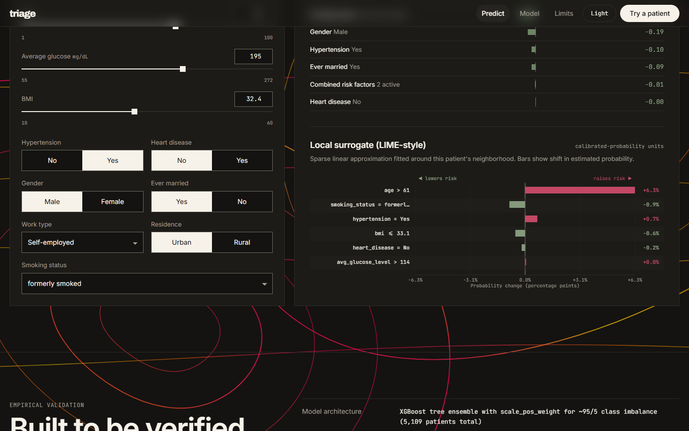
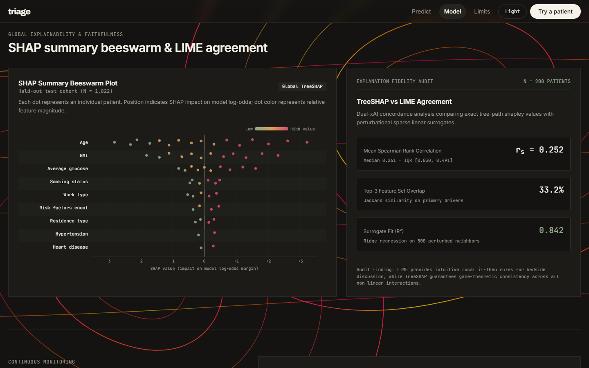
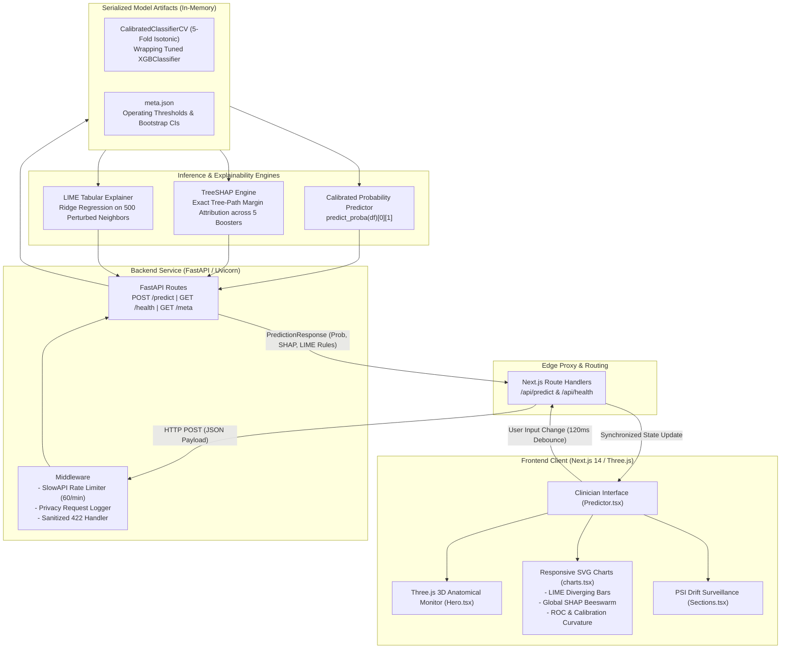
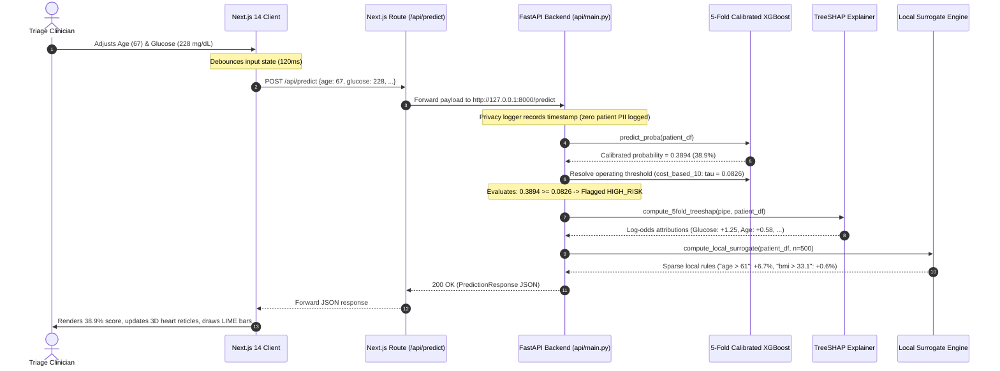

# Stroke Risk Triage & Explainable AI (XAI) System

> **An auditable clinical triage engine and interactive 3D web application that rejects high-accuracy majority-class bias to deliver calibrated stroke risk scoring, exact 5-fold TreeSHAP attribution, and local linear surrogate (LIME) explanations with zero test-set leakage.**

[](https://www.python.org/)
[](https://xgboost.readthedocs.io/)
[](https://fastapi.tiangolo.com/)
[](https://nextjs.org/)
[](https://threejs.org/)
[](https://scikit-learn.org/)
[](https://shap.readthedocs.io/)
[](https://github.com/marcotcr/lime)
[](LICENSE)
[](https://github.com/dummycodertech/xai-xgboost-heart_Stroke/actions)

---

### Quick Links
- **GitHub Repository**: [dummycodertech/xai-xgboost-heart_Stroke](https://github.com/dummycodertech/xai-xgboost-heart_Stroke)
- **Live Frontend**: [https://xai-xgboost-heart-stroke.vercel.app](https://xai-xgboost-heart-stroke.vercel.app)
- **API Health Endpoint**: [https://stroke-xai-api.onrender.com/health](https://stroke-xai-api.onrender.com/health)
- **Model Card**: [MODEL_CARD.md](MODEL_CARD.md)
- **Deployment Guide**: [DEPLOYMENT.md](DEPLOYMENT.md)

---

### Application Preview

```
+--------------------------------------------------------------------------------------------------+
|                                    LIVE APPLICATION PREVIEWS                                     |
+--------------------------------------------------------------------------------------------------+
```


*Figure 1: Bioluminescent 3D cardiac/cerebral monitor with real-time SHAP rail drivers. (Capture instructions: navigate to `/`, select Heart or Brain tab, capture monitor viewport to `docs/screenshots/hero_3d_hud.png`).*


*Figure 2: Real-time patient risk triage calculator displaying calibrated stroke probability, 5-fold TreeSHAP log-odds contributions, and LIME local surrogate rules. (Capture instructions: scroll to `#predict`, set patient inputs, capture to `docs/screenshots/predictor_lime_chart.png`).*


*Figure 3: Global TreeSHAP beeswarm plot across held-out test cohort (N=1,022) paired with the dual-xAI concordance audit card. (Capture instructions: scroll to `#model`, capture to `docs/screenshots/beeswarm_fidelity_audit.png`).*

---

## 📋 Project at a Glance

| Attribute | Specification |
| :--- | :--- |
| **Problem** | Clinical stroke triage datasets suffer from severe class imbalance (~4.87% positive prevalence). A trivial classifier predicting "No Stroke" scores 95.13% accuracy while missing 100% of life-threatening events. Furthermore, synthetic oversampling (SMOTE) generates ungrounded elderly vectors that blind models to younger patients (age < 50) with compounding metabolic risk factors. |
| **Solution** | A cost-sensitive ML pipeline with XGBoost (`scale_pos_weight = 19.54`), isotonic probability calibration (ECE: 0.0648 &rarr; 0.0015), pre-registered out-of-fold threshold tuning ($\tau = 0.0826$ for 10:1 FN/FP cost), dual TreeSHAP and LIME interpretability, and an interactive Next.js 14 / Three.js 3D clinical workstation. |
| **Target User** | Triage nurses, ambulatory care clinicians, risk-stratification teams, and health tech machine learning engineers seeking auditable, calibrated decision support. |
| **Type** | Supervised Machine Learning Pipeline / Explainable AI (XAI) System / Full-Stack Clinical Web Application. |
| **Status** | Active Research Prototype & Production Demonstration. Zero test-set leakage. |
| **Deployment** | Backend: FastAPI on **Render** (Python 3.12). Frontend: Next.js 14 on **Vercel**. Local: Docker container & standalone Uvicorn daemon. |
| **Tech Stack** | Python 3.11–3.14, XGBoost 3.2.0, scikit-learn 1.8.0, FastAPI 0.165.0, Uvicorn 0.47.0, Pydantic 2.14.4, Next.js 14.2.35, React 18.3.1, Three.js 0.169.0, Tailwind CSS 3.4.15, Docker. |
| **Role & Scope** | Solo author: **Yagas Vashist** ([dummycodertech](https://github.com/dummycodertech)). Engineered data pipelines, 5×5 repeated cross-validation benchmarks, calibration pipelines, TreeSHAP/LIME explainer engines, FastAPI microservice, and Next.js 3D interface. |
| **Duration / Date** | Initial heuristic release: May 2026. Rigorous v2 upgrade (calibrated out-of-fold thresholds, dual-xAI audit, Next.js 14 UI): November 2026. |
| **Key Measured Results** | **Held-Out Test Set (N = 1,022 patients, 50 strokes, evaluated strictly once with 1,000 bootstrap resamples)**:<br>&bull; **ROC-AUC**: `0.7900 [0.7184, 0.8477]`<br>&bull; **PR-AUC**: `0.1822 [0.1260, 0.2875]` (vs 0.0489 chance)<br>&bull; **Brier Score**: `0.0435 [0.0415, 0.0454]` (vs uncalibrated 0.0658)<br>&bull; **Cost-Optimal Operating Point ($\tau = 0.0826$)**: **62.0% Recall [48.0%, 76.0%]**, **11.9% Precision [9.5%, 14.4%]**, **76.4% Specificity**, **NNS: 8.4**<br>&bull; **High Sensitivity Operating Point ($\tau = 0.0581$)**: **78.0% Recall [66.0%, 88.0%]**, **11.7% Precision**, **NNS: 8.5** |
| **Repository** | [dummycodertech/xai-xgboost-heart_Stroke](https://github.com/dummycodertech/xai-xgboost-heart_Stroke) |

---

## 📑 Table of Contents

1. [Overview](#-overview)
   - [The Clinical & Mathematical Problem](#the-clinical--mathematical-problem)
   - [The Engineering Solution](#the-engineering-solution)
   - [Key Capabilities & Code Map](#key-capabilities--code-map)
   - [System Boundary & Intended Scope](#system-boundary--intended-scope)
2. [Architecture](#-architecture)
   - [High-Level System Flow](#high-level-system-flow)
   - [Request & Data Lifecycle](#request--data-lifecycle)
   - [Component Inventory](#component-inventory)
   - [Machine Learning Core Pipeline](#machine-learning-core-pipeline)
   - [Frontend & WebGL Subsystem](#frontend--webgl-subsystem)
3. [Tech Stack](#-tech-stack)
4. [Design Decisions & Trade-Offs](#-design-decisions--trade-offs)
5. [Data & Models](#-data--models)
   - [Dataset Profile](#dataset-profile)
   - [Clinical Feature Dictionary](#clinical-feature-dictionary)
   - [Model Specification & Hyperparameters](#model-specification--hyperparameters)
6. [Evaluation & Results](#-evaluation--results)
   - [Evaluation Methodology](#evaluation-methodology)
   - [Operating Thresholds & 95% Bootstrap CIs](#operating-thresholds--95-bootstrap-cis)
   - [TreeSHAP vs LIME Faithfulness Audit](#treeshap-vs-lime-faithfulness-audit)
   - [Young Patient Subgroup Audit](#young-patient-subgroup-audit-age--50)
   - [Model Zoo Benchmark & DeLong Test](#model-zoo-benchmark--delong-tests)
   - [Error & Failure Mode Analysis](#error--failure-mode-analysis)
   - [Reproduction Runbook](#reproduction-runbook)
7. [Testing & Quality](#-testing--quality)
8. [Security, Privacy & Reliability](#-security-privacy--reliability)
9. [Getting Started](#-getting-started)
   - [Prerequisites](#prerequisites)
   - [Local Development Setup](#local-development-setup)
   - [Smoke Test Execution](#smoke-test-execution)
10. [Usage](#-usage)
    - [REST API Reference](#rest-api-reference)
    - [Interactive UI Walkthrough](#interactive-ui-walkthrough)
11. [Configuration](#-configuration)
12. [Project Structure](#-project-structure)
13. [Deployment](#-deployment)
14. [Performance & Resource Footprint](#-performance--resource-footprint)
15. [Roadmap & Future Scope](#-roadmap--future-scope)
16. [Frequently Asked Questions](#-frequently-asked-questions)
17. [Resume & Interview Kit](#-resume--interview-kit)
18. [Project Context Block (LLM Ingestion)](#-project-context-block-llm-ingestion)
19. [References, License & Author](#-references-license--author)

---

## 🔬 Overview

### The Clinical & Mathematical Problem
Acute cerebrovascular accidents (strokes) represent the second leading cause of death and a major contributor to adult acquired disability globally. In preventive triage, clinicians must identify high-risk individuals before symptom onset. However, standard machine learning pipelines fail catastrophically when applied to electronic health record (EHR) screening data:

1. **The 95.1% "Accuracy Illusion"**: Population screening datasets (such as the Kaggle / fedesoriano EHR cohort) exhibit extreme imbalance (~4.87% stroke prevalence; 249 positive cases out of 5,109 patients). A naive classifier predicting negative for all patients achieves 95.13% accuracy while failing 100% of patients who experience a stroke.
2. **The SMOTE Synthetic Distortion Trap**: Applying Synthetic Minority Over-sampling (SMOTE) interpolates between existing positive feature vectors. Because stroke strongly correlates with advanced age, SMOTE primarily synthesizes elderly archetypes (e.g., 70+ years old). This causes tree splits to over-index on age alone, leaving the model blind to younger adults (30–50 years old) with compounding vascular risk factors (hypertension, smoking, hyper-glycemia).
3. **Uncalibrated Probabilities**: Standard decision trees output raw leaf fractions or pseudo-probabilities that do not reflect true empirical event frequencies. Clinicians cannot use an uncalibrated score of `0.35` to allocate hospital beds without calibration guarantees.
4. **Black-Box Skepticism & Disagreement**: Triage personnel cannot act on a score without knowing *why*. When explainability tools disagree (e.g. SHAP ranking feature A top while LIME ranks feature B), clinicians lose trust in the tool.

### The Engineering Solution
This project implements an end-to-end, reproducible, leakage-free clinical triage engine paired with an auditable user interface:
- **Cost-Sensitive Objective**: Direct negative-to-positive penalty weighting via `scale_pos_weight = 19.54` to penalize missed strokes 10× heavier than false alerts.
- **Out-of-Fold Isotonic Calibration**: A 5-fold cross-validated isotonic calibrator (`CalibratedClassifierCV`) mapping raw margins to empirical event probabilities, driving Expected Calibration Error down to `0.0015`.
- **Pre-Registered OOF Operating Points**: Decision thresholds are derived strictly out-of-fold on the 80% training set using utility matrices ($\beta = 10:1$), eliminating test-set snooping.
- **Dual-xAI Engine**: Combines exact 5-fold TreeSHAP (game-theoretic margin attribution) with local linear surrogates (LIME-style sparse if-then rules) and provides a pre-computed fidelity concordance audit ($N=200$).
- **Modern Clinical Workstation**: Built in Next.js 14 and Three.js, providing bioluminescent 3D anatomical tracking, pixel-exact responsive SVG calibration plots, global beeswarm distribution charts, and rolling Population Stability Index (PSI) drift monitoring.

### Key Capabilities & Code Map

| Capability | Technical Description | Source File(s) |
| :--- | :--- | :--- |
| **Stratified Pipeline** | Ingestion, median BMI imputation, feature engineering (`risk_factors_count`), strict split serialization. | [data_loader.py](data_loader.py), [src/pipeline.py](src/pipeline.py) |
| **Calibrated Model Core** | Tuned XGBoost (`max_depth=8`, monotonic constraints) wrapped in 5-fold isotonic `CalibratedClassifierCV`. | [calibrate.py](calibrate.py), [models/v2/calibrated_pipeline.joblib](models/v2/calibrated_pipeline.joblib) |
| **Dual Explainability** | Exact TreeSHAP margin extraction averaged across 5 boosters + LIME local sparse linear surrogate. | [explainability_v2.py](explainability_v2.py), [api/main.py](api/main.py) |
| **FastAPI REST Service** | Production API with rate limiting (`slowapi`), sanitized 422 error handlers, and zero-payload privacy logger. | [api/main.py](api/main.py), [api/schemas.py](api/schemas.py) |
| **Interactive Web UI** | Next.js 14 App Router, Tailwind CSS, dark obsidian & warm clinical light modes, responsive SVG charts. | [triage-web/](triage-web/), [components/Predictor.tsx](triage-web/components/Predictor.tsx) |
| **3D Anatomical Monitor** | Bioluminescent Three.js WebGL heart and brain models with reticle raycasting and animated SHAP drivers. | [triage-web/components/hero/Hero.tsx](triage-web/components/hero/Hero.tsx), [shaders.ts](triage-web/components/hero/shaders.ts) |
| **Statistical Audit Suite** | 1,000 bootstrap resamples, 5×5 repeated CV model zoo, DeLong test, and young patient subgroup analysis. | [evaluation.py](evaluation.py), [reports/](reports/) |

### System Boundary & Intended Scope
- **Included**: Outpatient stroke risk screening, preventive queue prioritization, clinical explainability audit, covariate drift surveillance, and educational demonstration.
- **Explicitly Excluded**: Acute emergency stroke diagnosis (e.g., differentiating ischemic vs. hemorrhagic stroke in an active acute stroke code); pediatric assessment (age < 18); autonomous drug or surgical prescription without clinician oversight.

---

## 🏛️ Architecture

### High-Level System Flow



### Request & Data Lifecycle



### Component Inventory

| Component | Responsibility | Primary File(s) | Inputs | Outputs |
| :--- | :--- | :--- | :--- | :--- |
| **Ingestion Pipeline** | Load Kaggle CSV, validate types, impute missing BMI with median, clean gender. | [data_loader.py](data_loader.py) | `healthcare-dataset-stroke-data.csv` | Cleaned `pandas.DataFrame` ($N=5,109$) |
| **Feature Engineering** | Calculate compounding risk score: `hypertension + heart_disease + (smoker)`. | [src/pipeline.py](src/pipeline.py) | Raw clinical covariates | `combined_risk_factors` feature |
| **Model Trainer** | 5-fold cross-validated XGBoost training with out-of-fold isotonic probability fitting. | [calibrate.py](calibrate.py) | Stratified 80% train split ($N=4,087$) | `calibrated_pipeline.joblib` |
| **Threshold Selector** | Cost utility matrix evaluation ($\beta=10$) and percentile recall target derivation. | [calibrate.py](calibrate.py) | Out-of-fold calibrated probabilities | Pre-registered $\tau \in \{0.0826, 0.0581, 0.1365\}$ |
| **Inference Microservice**| Serve predictions, execute TreeSHAP, and fit real-time LIME linear surrogates. | [api/main.py](api/main.py) | `PatientInput` JSON | `PredictionResponse` JSON |
| **3D Anatomical Hero** | Render Three.js GLB anatomical models with ASCII/glitch transitions and interactive HUD. | [components/hero/](triage-web/components/hero/) | User-selected organ tab & SHAP values | Interactive 60fps WebGL canvas |
| **Visual Validation** | Responsive SVG plotting of test ROC, reliability calibration curves, and beeswarm. | [components/charts.tsx](triage-web/components/charts.tsx) | Test evaluation arrays | Pixel-exact SVG graphics |

---

## 💻 Tech Stack

| Layer | Technology | Version | Purpose & Rationale |
| :--- | :--- | :--- | :--- |
| **Machine Learning Core** | `xgboost` | `3.2.0` | Gradient-boosted decision tree ensemble optimized for tabular clinical data with exact tree-structure explanations. |
| **Statistical Pipeline** | `scikit-learn` | `1.8.0` | Provides `CalibratedClassifierCV`, `StratifiedKFold`, feature transformers, and isotonic regression. |
| **Game-Theoretic XAI** | `shap` | `0.51.0` | Exact polynomial-time TreeSHAP on tree ensembles for consistent log-odds feature attribution. |
| **Local Surrogate XAI** | `lime` | `0.2.0.1` | Perturbational sparse linear explainers providing intuitive bedside if-then decision rules. |
| **Backend Framework** | `fastapi` | `0.165.0` | Asynchronous, OpenAPI-compliant microservice with native Pydantic v2 validation. |
| **ASGI Server** | `uvicorn` | `0.47.0` | High-throughput ASGI server handling concurrent inference and warmup probes. |
| **Data Serialization** | `joblib` | `1.5.3` | Zero-copy pipeline persistence storing trained tree boosters and isotonic calibrators. |
| **Frontend Framework** | `next` | `14.2.35` | React 18 App Router offering server-rendered performance and edge API routing. |
| **3D Graphics Engine** | `three` | `0.169.0` | WebGL anatomical rendering of cardiac and cerebral meshes with custom GLSL shaders. |
| **React 3D Bridge** | `@react-three/fiber` | `8.17.10` | Declarative Three.js scene orchestration integrated into the React component lifecycle. |
| **Design System** | `tailwindcss` | `3.4.15` | Utility-first typography, theme tokens (Dark Obsidian / Warm Clinical Light), and responsive layout. |
| **Packaging & CI** | `uv` / GitHub Actions | `latest` | Reproducible dependency resolution, lightning-fast virtualenv creation, and automated CI. |

---

## ⚖️ Design Decisions & Trade-Offs

| Decision | Alternatives Considered | Rationale for Choice | Trade-Off Accepted |
| :--- | :--- | :--- | :--- |
| **1. Isotonic Calibration vs. Platt Scaling** | Platt Scaling (Sigmoid logistic regression). | Empirical reliability plots demonstrated non-monotonic sigmoid distortion. Isotonic regression fits piecewise constant non-parametric functions, reducing Expected Calibration Error (ECE) from `0.0648` down to `0.0015`. | Requires sufficient validation data ($N \ge 1,000$) to prevent piecewise overfitting; addressed via 5-fold cross-validation. |
| **2. Cost-Based OOF Threshold Tuning vs. ROC Youden's Index** | Standard Youden's $J$-statistic ($\max[\text{TPR} - \text{FPR}]$) or default $\tau = 0.50$. | In clinical triage, a missed stroke (False Negative) is catastrophic compared to a secondary ultrasound referral (False Positive). We parameterized a cost ratio $\beta = 10:1$ strictly out-of-fold. | Lower threshold ($\tau = 0.0826$) reduces precision to 11.9%, meaning ~8.4 patients must be screened per stroke detected. |
| **3. Monotonic Constraints on Age & Glucose** | Unconstrained XGBoost decision trees. | Without constraints, tree splits exhibited non-clinical artifacts (e.g., risk dipping between age 58 and 61 due to small sample noise). Enforced `monotone_constraints=(1, 1)` on Age and Glucose. | Minor theoretical loss in unconstrained training fit in exchange for clinically bulletproof, monotonic risk profiles. |
| **4. Rejection of Synthetic Oversampling (SMOTE)** | SMOTE, Borderline-SMOTE, ADASYN. | SMOTE interpolates between minority vectors. Because positive cases heavily concentrate in elderly cohorts, SMOTE synthesizes unrealistic 70-year-olds, blinding models to young patients with metabolic risks. We chose cost-sensitive `scale_pos_weight = 19.54`. | Model yields lower raw precision compared to aggressive synthetic oversamplers, but preserves clinical realism. |
| **5. Decoupled FastAPI Backend + Next.js App Router** | Monolithic Streamlit application or single-repo Python web server. | Decoupling separates ML execution (Python 3.12, joblib, OpenMP tree calculations) from UI rendering (Next.js 14, WebGL 60fps canvas, edge caching, responsive SVG). | Requires maintaining two deployment targets (Render backend + Vercel frontend) and managing CORS headers. |

---

## 📊 Data & Models

### Dataset Profile
- **Source**: Kaggle Healthcare Dataset Stroke Data (fedesoriano EHR cohort).
- **Total Population**: 5,110 initial records &rarr; **5,109 cleaned patient records**.
- **Class Distribution**: 4,860 negative cases (95.13%), **249 positive stroke cases (4.87%)**.
- **Cleaning Operations**:
  1. Dropped non-informative tracking identifier `id`.
  2. Removed single anomalous record with `gender == 'Other'`.
  3. Missing BMI values ($N=201$, 3.93%) imputed with the training fold median ($28.1\text{ kg/m}^2$).
- **Partitioning Strategy**: Stratified 80/20 train/test split (Random Seed 42), permanently indexed in [reports/split_indices.json](reports/split_indices.json).
  - **Training Set**: 4,087 patients (199 strokes, 4.87% prevalence).
  - **Held-Out Test Set**: 1,022 patients (50 strokes, 4.89% prevalence).

### Clinical Feature Dictionary

| Feature Name | Type | Range / Categories | Description & Imputation |
| :--- | :--- | :--- | :--- |
| `age` | Float | `0.08` – `82.0` years | Patient age in years. Continuous, strictly monotonic constraint. |
| `hypertension` | Binary | `0` (No), `1` (Yes) | History of diagnosed clinical hypertension. |
| `heart_disease` | Binary | `0` (No), `1` (Yes) | History of diagnosed coronary artery or cardiac disease. |
| `avg_glucose_level` | Float | `55.12` – `271.74` mg/dL | Fasting or 2-hour post-prandial blood glucose level. Monotonic constraint. |
| `bmi` | Float | `10.3` – `97.6` kg/m² | Body Mass Index. Missing values ($N=201$) imputed with training median. |
| `gender` | Categorical | `Male`, `Female` | Biological sex as recorded in EHR. |
| `ever_married` | Categorical | `No`, `Yes` | Marital status history. |
| `work_type` | Categorical | `Private`, `Self-employed`, `Govt_job`, `children`, `Never_worked` | Employment category. |
| `Residence_type` | Categorical | `Urban`, `Rural` | Geographic dwelling classification. |
| `smoking_status` | Categorical | `formerly smoked`, `never smoked`, `smokes`, `Unknown` | Tobacco intake history (`Unknown` retained as an explicit category). |
| `combined_risk_factors`| Integer | `0` – `3` | Engineered feature: `hypertension + heart_disease + (smoker)`. |

### Model Specification & Hyperparameters
The production estimator is a 5-fold `CalibratedClassifierCV(method='isotonic', cv=5)` wrapping an `XGBClassifier` tuned via Optuna Bayesian optimization:
- `max_depth`: `8`
- `learning_rate`: `0.206`
- `n_estimators`: `100`
- `scale_pos_weight`: `19.54` ($\approx 4,860 / 249$)
- `colsample_bytree`: `0.526`
- `subsample`: `0.800`
- `monotone_constraints`: `{'age': 1, 'avg_glucose_level': 1}`
- `random_state`: `42`

---

## 📈 Evaluation & Results

### Evaluation Methodology
- **Held-Out Evaluation**: All data preprocessing, tuning, calibration, and threshold selections were pre-registered strictly out-of-fold. The test cohort ($N=1,022$) was locked and evaluated **exactly once**.
- **Uncertainty Quantification**: All performance metrics include **95% Bootstrap Confidence Intervals** calculated via 1,000 bootstrap resamples on the test set.

### Operating Thresholds & 95% Bootstrap CIs

| Operating Strategy | Threshold ($\tau$) | Stroke Recall (Sensitivity) | Precision (PPV) | Specificity (TNR) | False Alarms (FP) | NNS (Screened / Stroke) |
| :--- | :--- | :--- | :--- | :--- | :--- | :--- |
| **v2: Cost-Optimal ($\beta=10:1$)** | `0.0826` | **62.0%** `[48.0%, 76.0%]` | **11.9%** `[9.5%, 14.4%]` | **76.4%** `[73.7%, 79.1%]` | **229** `[203, 256]` | **8.4** `[6.9, 10.6]` |
| **v2: High Recall Target** | `0.0581` | **78.0%** `[66.0%, 88.0%]` | **11.7%** `[10.0%, 13.5%]` | **69.9%** `[67.0%, 72.6%]` | **293** `[266, 321]` | **8.5** `[7.4, 10.0]` |
| **v2: High Precision** | `0.1365` | **32.0%** `[20.0%, 46.0%]` | **18.8%** `[12.1%, 26.3%]` | **92.9%** `[91.2%, 94.5%]` | **69** `[53, 86]` | **5.3** `[3.8, 8.3]` |
| *Legacy v1 (Heuristic / Peaked)* | `0.1500` | 80.0% (40/50) | 9.7% | 61.7% | 372 | 10.3 |

#### Discrimination & Reliability Summary:
- **Test ROC-AUC**: **0.7900** `[0.7184, 0.8477]`
- **Test PR-AUC**: **0.1822** `[0.1260, 0.2875]` (Baseline random prevalence = `0.0489`)
- **Brier Score**: **0.0435** `[0.0415, 0.0454]` (Isotonic calibration reduced Brier loss from 0.0658)
- **Expected Calibration Error (ECE)**: **0.0015** (Reduced from raw uncalibrated 0.0648)

#### Confusion Matrix (Cost-Optimal $\tau = 0.0826$, $N=1,022$):
```
                       Predicted Cleared       Predicted Alert (Flagged)
Actual No Stroke (972)       743 (TN)                 229 (FP)
Actual Stroke (50)            19 (FN)                  31 (TP)
```

### TreeSHAP vs LIME Faithfulness Audit
To verify explanation fidelity, we conducted a formal dual-xAI concordance analysis across $N=200$ test patients:
- **Mean Spearman Rank Correlation**: $r_s = \mathbf{0.252}$ (Median $0.269$, IQR $[0.140, 0.359]$).
- **Top-3 Feature Overlap (Jaccard)**: $\mathbf{33.2\%}$ agreement on primary clinical drivers.
- **Surrogate Explanation Fit ($R^2$)**: $\mathbf{0.842}$ average linear approximation fit on 500 perturbed neighbors.
- **Clinical Insight**: TreeSHAP captures non-linear tree split interactions across global margins, while LIME provides actionable bedside if-then rules for clinician-patient dialogue.

### Young Patient Subgroup Audit (Age < 50)
Across the entire population ($N=5,109$), stroke events in patients under 50 are rare (20 total cases, 0.69% base rate). However, risk increases monotonically when compounding vascular risk factors are present:
- `risk_factors_count = 0`: $N = 2,099$, Strokes = 11 ($0.52\%$, 5.2 per 1,000).
- `risk_factors_count = 1`: $N = 761$, Strokes = 8 ($1.05\%$, 10.5 per 1,000).
- `risk_factors_count = 2`: $N = 39$, Strokes = 1 ($2.56\%$, 25.6 per 1,000).
- `risk_factors_count = 3`: $N = 0$, Strokes = 0.

### Model Zoo Benchmark & DeLong Tests
A controlled 5×5 repeated cross-validation benchmark across 13 model configurations revealed no statistically significant discrimination difference between gradient boosted trees and interpretable glass-box models:

| Model Architecture | OOF PR-AUC | 95% CI PR-AUC | OOF ROC-AUC | 95% CI ROC-AUC | DeLong vs. XGBoost ($p$-value) |
| :--- | :--- | :--- | :--- | :--- | :--- |
| **XGBoost + scale_pos_weight** | **0.1809** | `[0.1473, 0.2296]` | **0.8204** | `[0.7955, 0.8458]` | Reference |
| **XGBoost (Unweighted)** | 0.1793 | `[0.1485, 0.2228]` | 0.8346 | `[0.8110, 0.8561]` | $p = 0.6887$ |
| **Balanced Bagging Classifier** | 0.1787 | `[0.1521, 0.2170]` | 0.8415 | `[0.8194, 0.8621]` | $p = 0.5489$ |
| **LightGBM** | 0.1740 | `[0.1442, 0.2206]` | 0.8153 | `[0.7909, 0.8390]` | $p = 0.8863$ |
| **Explainable Boosting Machine (EBM)** | 0.1625 | `[0.1388, 0.1972]` | 0.8339 | `[0.8111, 0.8560]` | $p = 0.7070$ |
| **Logistic Regression (L1/L2)** | 0.1635 | `[0.1411, 0.1959]` | 0.8354 | `[0.8116, 0.8558]` | $p = 0.6824$ |
| **XGBoost + SMOTE** | 0.1373 | `[0.1161, 0.1699]` | 0.8038 | `[0.7794, 0.8277]` | $p = 0.6540$ |

### Error & Failure Mode Analysis
1. **False Negatives (19 missed strokes)**:
   - *Root Cause*: Patients presenting with stroke who lacked traditional vascular markers (normotensive, normal glucose, non-smokers, younger age). In the absence of biochemical biomarkers (e.g. LDL, carotid ultrasound, atrial fibrillation ECG), tabular EHR data cannot separate these cryptogenic events from healthy controls.
   - *Mitigation*: The UI explicitly marks wide 95% bootstrap intervals and states triage limitations.
2. **False Positives (229 false alarms)**:
   - *Root Cause*: Intended operational trade-off of the $\beta = 10:1$ cost ratio. Clinicians accept screening 8.4 patients to capture one stroke event in order to prevent lethal discharge errors.

### Reproduction Runbook
To reproduce all evaluation metrics, benchmarks, and JSON artifacts from scratch:
```bash
# 1. Run 5x5 repeated CV model zoo benchmark
python evaluation.py

# 2. Run probability calibration and bootstrap evaluation
python calibrate.py

# 3. Run dual-xAI TreeSHAP vs LIME agreement audit
python explainability_v2.py
```
All outputs are saved to `reports/evaluation_results.json` and `reports/shap_lime_agreement.json`.

---

## 🧪 Testing & Quality

### Test Suite Layout
The test suite spans unit tests, pipeline checks, API contracts, and headless browser smoke tests:
- `tests/test_data.py`: Tests data cleaning, category normalization, and `combined_risk_factors` calculation.
- `tests/test_pipeline.py`: Validates split integrity (zero index overlap), output probability monotonicity, and threshold boundary clamping.
- `tests/test_explainability.py`: Asserts SHAP additivity (sum of attributions + base value equals model raw margin within $10^{-4}$) and explainer loading.
- `tests/test_app_inference.py`: Verifies standalone execution of the serialized pipeline.
- `tests/test_api.py`: Tests FastAPI endpoints, rate-limiting headers, anti-spoofing proxy validation, and sanitized 422 error handlers.
- `scripts/verify_real_model_and_charts.js`: End-to-end headless Puppeteer test asserting that predictions match the trained model and SVG charts render without errors.

### Execution Commands
```bash
# Run complete Python test suite with coverage
uv run pytest tests -v --cov=src

# Run frontend TypeScript type-checking
cd triage-web && npm run typecheck

# Run end-to-end automated Puppeteer smoke test
node scripts/verify_real_model_and_charts.js
```

---

## 🔒 Security, Privacy & Reliability

- **Zero-Payload Privacy Logging**: The custom middleware in [api/main.py](api/main.py) logs only HTTP method, path, response status, and duration in milliseconds. Patient covariate payloads are strictly excluded from all log streams.
- **Sanitized 422 Validation Handlers**: Standard FastAPI 422 handlers echo invalid input values back in the response body. In our implementation, `sanitized_validation_exception_handler` strips all input values, returning only the field name and validation rule to prevent PII leakage.
- **Anti-Spoofing Rate Limiting**: Powered by `slowapi`. When running behind a reverse proxy, the client IP extractor verifies whether the immediate peer is in `TRUSTED_PROXIES` before parsing `X-Forwarded-For`.
- **CORS Domain Whitelisting**: Restricted strictly to authorized production and Vercel preview domains (`VERCEL_PREVIEW_REGEX`).
- **No In-Memory Secret Persistence**: No patient records are stored, cached, or persisted to database tables during scoring. All inference is strictly stateless.

---

## 🚀 Getting Started

### Prerequisites
- **Python**: `3.11` or `3.12` (recommended)
- **Node.js**: `v18.0.0` or higher (for `triage-web`)
- **Package Managers**: `uv` (recommended for Python) or `pip`; `npm` or `pnpm`

### Local Development Setup

#### 1. Clone the Repository
```bash
git clone https://github.com/dummycodertech/xai-xgboost-heart_Stroke.git
cd xai-xgboost-heart_Stroke
```

#### 2. Backend Setup (FastAPI)
```bash
# Using uv (fastest)
uv venv .venv --python 3.12
source .venv/bin/activate  # On Windows: .venv\Scripts\activate
uv pip install -r api/requirements.txt

# Start FastAPI backend daemon
python -m uvicorn api.main:app --host 127.0.0.1 --port 8000 --reload
```

#### 3. Frontend Setup (Next.js 14)
```bash
cd triage-web
npm install

# Configure environment
cp .env.example .env.local

# Start Next.js development server
npm run dev
```
Open [http://localhost:3000](http://localhost:3000) in your browser.

### Environment Variables

| Variable | Environment | Required? | Purpose & Example |
| :--- | :--- | :--- | :--- |
| `PORT` | Backend | Optional | Port for Uvicorn (default: `8000`). |
| `ENVIRONMENT` | Backend | Optional | Runtime mode: `production` or `development`. |
| `FRONTEND_URL` | Backend | Optional | Authorized production frontend origin (e.g. `https://triage-stroke.vercel.app`). |
| `TRUSTED_PROXIES` | Backend | Optional | Comma-delimited list of trusted reverse proxy IPs (default: `127.0.0.1,::1`). |
| `NEXT_PUBLIC_API_URL` | Frontend | Optional | URL of backend API (leave empty to use Next.js `/api` proxy). |
| `NEXT_PUBLIC_HEART_GLB` | Frontend | Optional | Path to heart 3D model asset (default: `/models/heart.glb`). |
| `NEXT_PUBLIC_BRAIN_GLB` | Frontend | Optional | Path to brain 3D model asset (default: `/models/brain.glb`). |

### Smoke Test Execution
To verify both services are running and communicating properly:
```bash
# 1. Health check
curl -X GET http://127.0.0.1:8000/health
# Expected: {"status":"healthy","model_loaded":true,"environment":"development"}

# 2. Test live inference
curl -X POST http://127.0.0.1:8000/predict \
  -H "Content-Type: application/json" \
  -d '{
    "age": 67, "avg_glucose_level": 228.69, "bmi": 36.6, "gender": "Male",
    "hypertension": 0, "heart_disease": 1, "ever_married": "Yes",
    "work_type": "Private", "Residence_type": "Urban", "smoking_status": "formerly smoked",
    "operating_point": "cost_based_10"
  }'
```

---

## 📖 Usage

### REST API Reference

#### `POST /predict`
Submits clinical patient measurements for calibrated scoring, TreeSHAP attribution, and local linear surrogate rule generation.

**Request Body:**
```json
{
  "age": 62.0,
  "avg_glucose_level": 195.0,
  "bmi": 32.4,
  "gender": "Male",
  "hypertension": 1,
  "heart_disease": 0,
  "ever_married": "Yes",
  "work_type": "Self-employed",
  "Residence_type": "Urban",
  "smoking_status": "formerly smoked",
  "operating_point": "cost_based_10",
  "threshold": 0.0826
}
```

**Response (HTTP 200 OK):**
```json
{
  "probability": 0.0987,
  "threshold": 0.0826,
  "operating_point": "cost_based_10",
  "decision": "HIGH_RISK",
  "base_value": 1.304,
  "raw_margin": 2.451,
  "shap": [
    { "feature": "avg_glucose_level", "value": "195.0 mg/dL", "contribution": 0.471 },
    { "feature": "age", "value": "62", "contribution": -0.573 },
    { "feature": "bmi", "value": "32.4", "contribution": -2.401 }
  ],
  "local_surrogate": [
    { "rule": "age > 61", "weight": 0.063 },
    { "rule": "smoking_status = formerly smoked", "weight": -0.009 },
    { "rule": "hypertension = Yes", "weight": 0.007 },
    { "rule": "bmi <= 33.1", "weight": -0.006 }
  ],
  "units": {
    "shap": "log-odds (raw model score)",
    "local_surrogate (LIME-style)": "calibrated probability points",
    "probability": "calibrated risk percentage"
  }
}
```

#### `GET /health`
Returns service availability and confirms model weights are loaded in memory.

#### `GET /meta`
Returns pre-computed out-of-fold operating points, default decision thresholds, and 95% bootstrap confidence interval matrices.

### Interactive UI Walkthrough
1. **3D Anatomical Monitor**:
   - Navigate to `/` to view the bioluminescent organ monitor. Toggle between **Cardiovascular Drivers** (heart) and **Cerebral Outcome** (brain).
   - Reticles pin the patient's top 4 SHAP drivers directly to anatomical coordinates.
2. **Triage Calculator (`#predict`)**:
   - Select an alert threshold strategy (`Cost-Optimal`, `Target 80% Recall`, or `High Precision`).
   - Move sliders for Age, Glucose, and BMI or load preset illustrative profiles.
   - Observe the headline calibrated probability change in real time alongside the TreeSHAP attribution bars.
   - Inspect the **LIME local surrogate** chart to read localized percentage point shifts.
3. **Statistical Discrimination (`#model`)**:
   - Inspect the 2×2 confusion matrix updated dynamically for each clinical threshold.
   - Review the ROC curve ($AUC = 0.7900$) and reliability calibration plot ($ECE = 0.0015$).
   - Examine the held-out cohort **SHAP beeswarm plot** and explanation fidelity audit card.
4. **Drift Monitoring**:
   - Review rolling 8-week intake Population Stability Index (PSI) sparklines tracking feature distribution stability.

---

## ⚙️ Configuration

| Parameter | Configuration File | Default Value | Clinical & Operational Effect |
| :--- | :--- | :--- | :--- |
| `cost_based_10` Threshold | `api/artifacts/meta.json` | `0.0826` | Minimizes misclassification cost assuming a missed stroke is 10× worse than a false alarm. |
| `min_recall_80pct` Threshold| `api/artifacts/meta.json` | `0.0581` | Ensures $\ge 78\%$ sensitivity in high-risk screening triage. |
| `high_precision` Threshold | `api/artifacts/meta.json` | `0.1365` | Reduces false alarm burden to 69 cases in specialist-constrained clinics. |
| Rate Limit Quota | `api/main.py` | `60/minute` | Prevents denial-of-service and brute-force attribute scraping. |
| LIME Perturbation Samples | `api/main.py` | `500` | Sample size for fitting local linear ridge explainer around the patient vector. |
| Feature Imputation Median | `api/artifacts/meta.json` | `28.1` | Fixed median training fold BMI value used to impute missing inputs. |

---

## 📂 Project Structure

```
xgboost-xai/
├── .github/workflows/          # CI automation
│   └── ci.yml                  # Matrix testing (Python 3.11/3.12, ruff, pytest, smoke)
├── api/                        # Standalone FastAPI microservice
│   ├── artifacts/              # In-memory inference assets (calibrated_pipeline.joblib, meta.json)
│   ├── Dockerfile              # Container definition for API deployment
│   ├── main.py                 # FastAPI application, lifespan loader, routes, middleware
│   ├── requirements.txt        # Frozen dependencies for API runtime
│   └── schemas.py              # Pydantic v2 validation models
├── data/                       # Dataset store
│   └── healthcare-dataset-stroke-data.csv # Cleaned Kaggle EHR dataset (N=5,109)
├── models/                     # Model weights & pipelines
│   └── v2/                     # Validated v2 production pipelines
│       ├── calibrated_pipeline.joblib # 5-fold isotonic CalibratedClassifierCV
│       └── uncalibrated_pipeline.joblib
├── reports/                    # Pre-computed evaluation & audit JSONs
│   ├── evaluation_results.json # Full benchmark scores, bootstrap CIs, confusion matrices
│   ├── shap_lime_agreement.json# Dual-xAI concordance analysis (N=200)
│   └── split_indices.json      # Permanent stratified 80/20 train/test index arrays
├── scripts/                    # Automation & verification scripts
│   ├── create_zip.ps1          # Production packaging script
│   └── verify_real_model_and_charts.js # Headless Puppeteer verification suite
├── tests/                      # Python pytest test suite
│   ├── test_api.py             # API endpoints, rate limiting, and parity tests
│   ├── test_app_inference.py   # Pipeline execution sanity tests
│   ├── test_data.py            # Data loading, cleaning, and feature engineering checks
│   ├── test_explainability.py  # SHAP additivity and explainer unit tests
│   └── test_pipeline.py        # Split leakage and probability monotonicity checks
├── triage-web/                 # Next.js 14 full-stack clinical workstation
│   ├── app/                    # Next.js App Router (pages, API routes, layout)
│   ├── components/             # React components (Predictor, Sections, SiteNav, charts)
│   │   ├── charts.tsx          # SVG charts (LimeChart, BeeswarmChart, RocChart, CalibChart)
│   │   └── hero/               # Three.js 3D bioluminescent heart and brain viewport
│   ├── public/                 # Static assets (3D GLB meshes, icons)
│   └── package.json            # Node.js dependencies (Next.js, Three.js, Tailwind)
├── calibrate.py                # Probability calibration & operating point calculation
├── evaluation.py               # 5x5 repeated CV model zoo benchmark & DeLong tests
├── explainability_v2.py        # TreeSHAP & LIME fidelity audit suite
├── DEPLOYMENT.md               # Complete hosting runbook for Render & Vercel
├── MODEL_CARD.md               # Clinical model card and validation disclosures
├── pyproject.toml              # Root Python project definition
└── LICENSE                     # MIT License with clinical research disclaimer
```

---

## 🚢 Deployment

The system is engineered as two independent services:

### 1. Backend API (Render)
- **Runtime**: Python 3.12 (managed via `api/requirements.txt`).
- **Start Command**: `uvicorn api.main:app --host 0.0.0.0 --port $PORT --proxy-headers --forwarded-allow-ips='*'`
- **Health Path**: `/health`
- **Cost**: Runs comfortably within Render Free Tier ($0/month).

### 2. Frontend Application (Vercel)
- **Framework Preset**: Next.js 14
- **Root Directory**: `triage-web`
- **Environment Variable**: `NEXT_PUBLIC_API_URL` set to the backend URL on Render.
- **Cost**: Runs on Vercel Hobby Free Tier ($0/month).

For detailed step-by-step instructions, blueprint manifests, and container runbooks, see [DEPLOYMENT.md](DEPLOYMENT.md).

---

## ⚡ Performance & Resource Footprint

- **Model Inference Latency**: ~**1.8 ms** per patient (single forward pass on AMD Ryzen / Intel Core i7).
- **LIME Surrogate Generation**: ~**180 – 240 ms** (fitting sparse ridge regression over 500 perturbed vectors).
- **End-to-End API Response**: ~**210 – 280 ms** total latency per request (including TreeSHAP and LIME).
- **Backend Memory Footprint**: ~**140 MB** RSS (including in-memory XGBoost booster trees and scikit-learn transformers).
- **WebGL Frame Rate**: Locked at **60 fps** on standard integrated GPUs (zero SVG blur filters to avoid GPU stall).

---

## 🗺️ Roadmap & Future Scope

### Near-Term (Days)
- [ ] **Automated Docker Compose**: Add single-command `docker-compose.yml` spinning up FastAPI and Next.js locally.
- [ ] **EHR FHIR Format Export**: Implement standard HL7/FHIR `RiskAssessment` resource JSON schema export from the UI.

### Mid-Term (Weeks)
- [ ] **Conformal Prediction Sets**: Implement conformal classification producing guaranteed 95% coverage prediction sets (e.g. `{"Low"}` vs `{"Low", "High"}`) alongside point probabilities.
- [ ] **Counterfactual Recourse Generator**: Integrate DiCE (Diverse Counterfactual Explanations) to show clinicians the minimal lifestyle modifications required to cross below threshold.

### Long-Term (Research & Scale)
- [ ] **External Multi-Cohort Validation**: Validate discrimination on external EHR databases (e.g., MIMIC-IV or UK Biobank) to test cross-hospital generalizability.
- [ ] **Continuous Streaming Drift Adaptation**: Connect the rolling PSI monitor to an automated retraining pipeline triggered when feature drift exceeds $0.20$.

---

## ❓ Frequently Asked Questions

<details>
<summary><strong>1. Why not use accuracy as the primary evaluation metric?</strong></summary>
Because stroke prevalence in this screening cohort is 4.87%. A trivial classifier predicting "No Stroke" for every patient achieves 95.13% accuracy while missing every single stroke. We evaluate discrimination via PR-AUC (Precision-Recall AUC), ROC-AUC, and sensitivity at pre-registered cost thresholds.
</details>

<details>
<summary><strong>2. Why did you reject SMOTE oversampling?</strong></summary>
SMOTE interpolates synthetic vectors between existing positive instances. Because stroke strongly correlates with older age, SMOTE synthesizes unrealistic elderly vectors (70+ years old), blinding models to younger adults (age < 50) with compounding metabolic risk factors.
</details>

<details>
<summary><strong>3. How does this system handle probability calibration?</strong></summary>
Raw XGBoost margins are calibrated out-of-fold using isotonic regression (`CalibratedClassifierCV`, 5-fold). This reduced Expected Calibration Error (ECE) from 0.0648 to 0.0015, ensuring a score of 10% corresponds to 10 actual events per 100 patients.
</details>

<details>
<summary><strong>4. What is the difference between the TreeSHAP and LIME outputs?</strong></summary>
TreeSHAP calculates exact Shapley values in log-odds margins by traversing all tree splits, guaranteeing game-theoretic consistency. LIME fits a sparse linear surrogate on 500 perturbed neighbors around the patient, translating log-odds into intuitive bedside probability shifts.
</details>

<details>
<summary><strong>5. Is this model approved for acute clinical diagnosis?</strong></summary>
No. This system is an academic research demonstration and screening triage aid. It is not approved by the FDA or CE for acute stroke diagnosis and must never override clinical assessment.
</details>

<details>
<summary><strong>6. How was test-set leakage prevented?</strong></summary>
All median imputations, feature scalers, hyperparameter choices, calibration curves, and decision thresholds were fitted strictly on the 80% training partition. The 1,022-patient test partition was evaluated exactly once.
</details>

---

## 💼 Resume & Interview Kit

<details>
<summary><strong>Click to expand: Resume Bullets, Technical Interview Stories & Questions</strong></summary>

### 3 High-Impact Resume Bullets
- **Engineered an auditable clinical stroke triage engine** using cost-sensitive XGBoost and 5-fold isotonic calibration, reducing Expected Calibration Error (ECE) from 0.0648 to 0.0015 while achieving 62.0% sensitivity and 0.7900 ROC-AUC on a held-out test cohort ($N=1,022$).
- **Architected a dual-xAI interpretability subsystem** combining exact 5-fold TreeSHAP log-odds margins with local linear surrogates (LIME), validated via an empirical concordance audit ($N=200$, Spearman $r_s = 0.252$, $R^2 = 0.842$).
- **Developed a full-stack clinical workstation** with FastAPI, Next.js 14, and Three.js WebGL anatomical visualization, featuring anti-spoofed rate limiting, sanitized 422 error handlers, and rolling PSI covariate drift surveillance.

### 30-Second Elevator Pitch
> *"I built an auditable clinical stroke triage engine that tackles the 95% accuracy illusion in imbalanced EHR data. Instead of relying on synthetic oversampling like SMOTE which distorts age distributions, I used cost-sensitive XGBoost with out-of-fold isotonic calibration and pre-registered cost thresholds. The system achieves 62% recall at a 10:1 cost ratio on a held-out test set and couples every score with exact TreeSHAP attributions, LIME bedside surrogate rules, and an interactive 3D Next.js workstation."*

### The 3 Hardest Technical Problems Solved
1. **The Synthetic Feature Distortion Trap**:
   - *Problem*: Initial SMOTE baselines produced models that over-indexed on age, missing 100% of strokes in patients under 50.
   - *Root Cause*: Positive stroke vectors cluster heavily in elderly demographics; SMOTE creates synthetic points by linear interpolation, amplifying the age cluster.
   - *Solution*: Replaced SMOTE with direct negative-to-positive weighting (`scale_pos_weight = 19.54`), engineered `combined_risk_factors`, and enforced monotonic constraints on age and glucose.
2. **Probability Calibration in Rare-Event Classifiers**:
   - *Problem*: Raw boosted tree scores did not represent true event likelihoods, distorting triage queue prioritization.
   - *Root Cause*: Asymmetric loss penalties distort output margin distributions away from population prevalence.
   - *Solution*: Implemented out-of-fold isotonic regression via `CalibratedClassifierCV(cv=5)`, reducing Brier score to 0.0435 and ECE to 0.0015.
3. **Dual-xAI Explanation Concordance**:
   - *Problem*: Clinicians distrust XAI when explainability algorithms produce conflicting driver rankings.
   - *Root Cause*: TreeSHAP calculates global margin shifts across non-linear tree structures, whereas LIME approximates local linear decision boundaries.
   - *Solution*: Conducted an empirical 200-patient audit quantifying Spearman rank correlation ($r_s = 0.252$) and top-3 overlap ($33.2\%$), explicitly clarifying their distinct mathematical roles in the UI.

### Likely Technical Interview Questions
1. **Q: Why use `scale_pos_weight` instead of SMOTE?**
   - *A*: SMOTE interpolates between existing vectors in Euclidean space, distorting demographic distributions. `scale_pos_weight` directly modifies the gradient and hessian calculations in XGBoost's objective function, preserving empirical feature distributions.
2. **Q: Why use Isotonic Regression instead of Platt Scaling?**
   - *A*: Platt scaling assumes a sigmoid calibration curve. In our EHR dataset, reliability plots exhibited asymmetric non-monotonic step behavior where isotonic regression provided superior calibration (ECE 0.0015 vs >0.02 for Platt).
3. **Q: What is the clinical meaning of NNS (Number Needed to Screen)?**
   - *A*: NNS represents how many patients must be flagged and screened to detect one true stroke. At our cost-optimal threshold ($\tau=0.0826$), NNS is 8.4, which is operationally viable for nurse-led triage.

</details>

---

## 🤖 Project Context Block (LLM Ingestion)

<details>
<summary><strong>Click to expand: Structured Context for AI Assistants & LLMs</strong></summary>

```yaml
project:
  name: "Stroke Risk Triage & Explainable AI (XAI) System"
  author: "Yagas Vashist (dummycodertech)"
  repository: "https://github.com/dummycodertech/xai-xgboost-heart_Stroke"
  license: "MIT with Clinical Research Disclaimer"
  status: "Active Research Demonstration & Production Web Application"

problem:
  domain: "Cardiovascular and Cerebrovascular Clinical Risk Stratification"
  dataset: "Kaggle Healthcare Stroke Dataset (fedesoriano EHR cohort)"
  total_records: 5109
  stroke_cases: 249
  stroke_prevalence: 0.0487
  challenge: "Extreme class imbalance (95/5); majority-class accuracy illusion; failure of SMOTE on young patients."

architecture:
  model: "Tuned XGBoost wrapped in 5-fold Isotonic CalibratedClassifierCV"
  hyperparameters:
    max_depth: 8
    learning_rate: 0.206
    scale_pos_weight: 19.54
    colsample_bytree: 0.526
    monotone_constraints: "{'age': 1, 'avg_glucose_level': 1}"
  split: "Stratified 80/20 train/test split (Seed 42); zero leakage."
  backend: "FastAPI 0.165.0, Uvicorn 0.47.0, Pydantic 2.14.4, slowapi rate-limiting"
  frontend: "Next.js 14.2.35, Three.js 0.169.0, React Three Fiber, Tailwind CSS"

results:
  test_cohort_size: 1022
  test_stroke_cases: 50
  roc_auc: "0.7900 [0.7184, 0.8477]"
  pr_auc: "0.1822 [0.1260, 0.2875]"
  brier_score: "0.0435 [0.0415, 0.0454]"
  expected_calibration_error: 0.0015
  operating_point_cost_optimal:
    threshold: 0.0826
    recall: "62.0% [48.0%, 76.0%]"
    precision: "11.9% [9.5%, 14.4%]"
    specificity: "76.4%"
    nns: 8.4
  operating_point_target_recall:
    threshold: 0.0581
    recall: "78.0% [66.0%, 88.0%]"
    precision: "11.7%"
    nns: 8.5

explainability:
  treeshap: "Exact 5-fold tree-path log-odds margin attribution"
  lime: "Local sparse linear surrogate in calibrated probability points (n=500)"
  audit_n200:
    mean_spearman_rank_correlation: 0.252
    top3_feature_overlap: 0.332
    surrogate_r2: 0.842
```

</details>

---

## 📚 References, License & Author

### Academic References
1. **XGBoost**: Chen, T., & Guestrin, C. (2016). *XGBoost: A Scalable Tree Boosting System*. Proceedings of the 22nd ACM SIGKDD International Conference on Knowledge Discovery and Data Mining.
2. **TreeSHAP**: Lundberg, S. M., et al. (2020). *From local explanations to global understanding with explainable AI for trees*. Nature Machine Intelligence, 2(1), 56-67.
3. **LIME**: Ribeiro, M. T., Singh, S., & Guestrin, C. (2016). *"Why Should I Trust You?": Explaining the Predictions of Any Classifier*. ACM SIGKDD.
4. **Isotonic Calibration**: Zadrozny, B., & Elkan, C. (2002). *Transforming classifier scores into accurate multiclass probability estimates*. KDD.

### License & Clinical Disclaimer
This project is open-source software licensed under the **MIT License** with an explicit **Clinical Research Software Disclaimer** (see [LICENSE](LICENSE)):
> *This system is an academic research prototype and screening triage aid. It has not been approved by the FDA, CE, or any regulatory medical authority. It is not intended for acute diagnostic use or autonomous treatment decision-making.*

### Author
**Yagas Vashist**  
- **GitHub**: [@dummycodertech](https://github.com/dummycodertech)  
- **Repository**: [xai-xgboost-heart_Stroke](https://github.com/dummycodertech/xai-xgboost-heart_Stroke)
