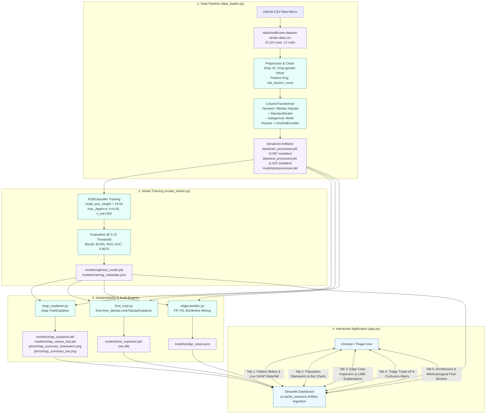
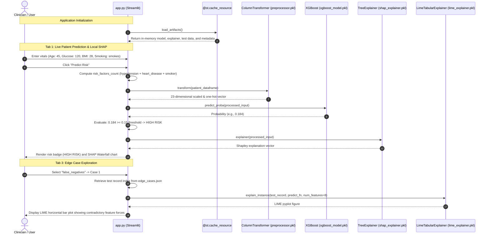

# Stroke Risk Prediction & Explainable AI (XAI) System

> **A clinical triage machine learning pipeline and interactive diagnostic dashboard that rejects high-accuracy majority-class bias to achieve 80.0% stroke recall using cost-sensitive XGBoost, dual SHAP/LIME interpretability, and post-hoc edge-case analysis.**

[](https://www.python.org/)
[](https://xgboost.readthedocs.io/)
[](https://shap.readthedocs.io/)
[](https://github.com/marcotcr/lime)
[](https://streamlit.io/)
[](https://scikit-learn.org/)
[](https://github.com/astral-sh/uv)
[](https://github.com/dummycodertech/xai-xgboost-heart_Stroke)

---

### Quick Links
- **GitHub Repository**: [dummycodertech/xai-xgboost-heart_Stroke](https://github.com/dummycodertech/xai-xgboost-heart_Stroke)
- **Live Demo**: [VERIFY: Enter live Streamlit Community Cloud URL if active, e.g., https://xai-stroke-prediction.streamlit.app/]
- **Dataset Source**: [Kaggle Healthcare Stroke Dataset Mirror](https://raw.githubusercontent.com/karavokyrismichail/Stroke-Prediction---Random-Forest/main/healthcare-dataset-stroke-data/healthcare-dataset-stroke-data.csv)

---

### Dashboard Preview

*Note: To capture this visual, launch `streamlit run app.py`, fill in sample patient features, click "Predict Risk", and save the resulting view to `docs/screenshots/dashboard_tab1.png`.*

---

## 📋 Project at a Glance

| Attribute | Details |
| :--- | :--- |
| **Problem** | Standard stroke prediction models suffer from the "accuracy illusion": in a dataset where 95.1% of patients do not suffer a stroke, a naive classifier predicting "No Stroke" achieves 95.1% accuracy while missing 100% of life-threatening events. Furthermore, synthetic oversampling (SMOTE) creates ungrounded 70-year-old archetypes, failing to alert clinicians to younger patients with compounding lifestyle risk factors. |
| **Solution** | A cost-sensitive ML pipeline with XGBoost that explicitly weights minority stroke cases by 19.54× (`scale_pos_weight`), incorporates custom feature engineering (`risk_factors_count`), adjusts the clinical classification threshold to 0.15, and pairs patient risk scoring with dual local/global XAI engines (SHAP TreeExplainer and LIME Tabular Explainer). |
| **Target User** | Clinical decision support staff, triage nurses, medical researchers, and health tech machine learning engineers seeking auditable, high-recall risk screening. |
| **Project Type** | Applied Supervised Machine Learning / Explainable AI (XAI) / Interactive Diagnostic Web Application. |
| **Status** | Active Prototype / Research Demonstration. Pipeline fully trained and pre-computed artifacts serialized. |
| **Deployment** | Local Streamlit runtime / Configured for Streamlit Community Cloud (model artifacts and datasets explicitly un-ignored in `.gitignore`). |
| **Tech Stack** | Python 3.14 / 3.11+, XGBoost 3.2.0, SHAP 0.51.0, LIME 0.2.0.1, Scikit-Learn 1.8.0, Dill 0.4.1, Pandas 3.0.3, Streamlit 1.57.0, UV package manager. |
| **Role & Scope** | Built by **Yagas Vashist** ([dummycodertech](https://github.com/dummycodertech)). Implemented complete pipeline: data ingestion, stratified preprocessing, hyperparameterized model training, XAI artifact serialization, edge-case mining, and Streamlit user interface. |
| **Duration / Date** | Initial Release: May 19, 2026. |
| **Key Measured Results** | **80.0% Stroke Recall (40/50 test strokes detected)** at **ROC-AUC: 0.8073**, **PR-AUC: 0.1691**, with false negatives restricted to 10 cases across 1,022 held-out test records (clinical decision threshold = 0.15). |
| **Repository** | [https://github.com/dummycodertech/xai-xgboost-heart_Stroke](https://github.com/dummycodertech/xai-xgboost-heart_Stroke) |

---

## 📑 Table of Contents
1. [Overview](#-overview)
   - [The Problem](#the-problem)
   - [The Solution](#the-solution)
   - [Key Features](#key-features)
   - [Scope & Boundary](#scope--boundary)
2. [Architecture](#-architecture)
   - [High-Level System Diagram](#high-level-system-diagram)
   - [End-to-End Execution Flow](#end-to-end-execution-flow)
   - [Component Inventory](#component-inventory)
   - [Machine Learning Specification](#machine-learning-specification)
   - [Web Application Architecture](#web-application-architecture)
3. [Tech Stack](#-tech-stack)
4. [Design Decisions & Trade-offs](#-design-decisions--trade-offs)
5. [Data & Models](#-data--models)
   - [Dataset Profile](#dataset-profile)
   - [Data Dictionary](#data-dictionary)
   - [Model Card: XGBoost Stroke Classifier](#model-card-xgboost-stroke-classifier)
6. [Evaluation & Results](#-evaluation--results)
   - [Evaluation Methodology](#evaluation-methodology)
   - [Performance Metrics Table](#performance-metrics-table)
   - [Confusion Matrix & Clinical Interpretation](#confusion-matrix--clinical-interpretation)
   - [Edge Case & Failure Mode Analysis](#edge-case--failure-mode-analysis)
   - [Reproduction Steps](#reproduction-steps)
7. [Testing & Quality](#-testing--quality)
8. [Security, Privacy & Reliability](#-security-privacy--reliability)
9. [Getting Started](#-getting-started)
   - [Prerequisites](#prerequisites)
   - [Installation via uv or venv](#installation-via-uv-or-venv)
   - [Smoke Test](#smoke-test)
10. [Usage](#-usage)
    - [Interactive Streamlit UI](#interactive-streamlit-ui)
    - [Running Offline Pipeline Modules](#running-offline-pipeline-modules)
11. [Configuration](#-configuration)
12. [Project Structure](#-project-structure)
13. [Deployment](#-deployment)
14. [Performance & Resource Profile](#-performance--resource-profile)
15. [Roadmap & Future Scope](#-roadmap--future-scope)
16. [Frequently Asked Questions](#-frequently-asked-questions)
17. [Resume & Interview Kit](#-resume--interview-kit)
18. [Project Context (LLM Agent Ingestion)](#-project-context-llm-agent-ingestion)
19. [References & Acknowledgements](#-references--acknowledgements)

---

## 🔬 Overview

### The Problem
Stroke is a leading cause of long-term disability and mortality worldwide. Early triage can dramatically improve patient survival and functional recovery. However, applying off-the-shelf classification algorithms to electronic health records introduces severe clinical failure modes:

1. **The 95% "Accuracy Illusion"**: In population stroke screening datasets (such as the Kaggle / fedesoriano dataset), positive stroke prevalence is roughly 4.87% (249 positives out of 5,110 records). A trivial model predicting 100% negative outcomes obtains 95.13% classification accuracy while possessing a clinical recall of 0.0%.
2. **The SMOTE Synthetic Bias Trap**: Synthetic Minority Over-sampling Technique (SMOTE) generates interpolated synthetic vectors. Because stroke incidence strongly correlates with advanced age, SMOTE primarily synthesizes elderly profiles (e.g., 70+ years old). This causes the classifier to heavily over-index on age alone, remaining blind to younger patients (30–50 years old) presenting severe compounding lifestyle risks (smoking, hypertension, diabetes).
3. **Black-Box Skepticism**: Physicians and triage personnel cannot act upon raw, uncalibrated risk probabilities without understanding *which specific physiological and lifestyle factors* contributed to an elevated risk score.

### The Solution
This repository implements an end-to-end Machine Learning and Explainable AI (XAI) triage framework:
- **Cost-Sensitive XGBoost**: Discards synthetic oversampling in favor of the real, unaltered training distribution, applying an exact `scale_pos_weight = 19.54` to penalize false negatives 20× higher than false alarms.
- **Compounding Risk Feature Engineering**: Introduces `risk_factors_count = hypertension + heart_disease + high_risk_smoker` to capture non-linear multivariable risk interactions.
- **Clinical Triage Thresholding**: Replaces the default statistical 0.50 cutoff with a calibrated 0.15 threshold, driving stroke recall to 80.0% on the held-out test set.
- **Dual XAI Interpretation Suite**: 
  - **SHAP (TreeExplainer)**: Computes exact Shapley values for both global population dynamics (Beeswarm, Bar plots) and instant per-patient local waterfall attribution.
  - **LIME (LimeTabularExplainer)**: Provides perturbation-based local feature importance specifically targeted at diagnosed model edge cases (False Positives, False Negatives, and 45–55% Uncertain boundaries).
- **Interactive Multi-Tab Dashboard**: Built on Streamlit to allow real-time clinical parameter adjustments, instant attribution rendering, and model transparency exploration.

### Key Features

| Feature | What It Does | Code Location |
| :--- | :--- | :--- |
| **Automated Data Ingestion & Imputation** | Downloads raw dataset, strips non-predictive identifiers (`id`), drops ambiguous gender records (`Other`), imputes missing BMI using median statistics, and performs stratified 80/20 train/test splitting. | [`data_loader.py`](data_loader.py) |
| **Risk Multiplier Feature Engineering** | Computes a composite lifestyle risk score (`risk_factors_count`) combining hypertension, heart disease, and active/former smoking status. | [`data_loader.py:43-48`](data_loader.py#L43-L48) |
| **Cost-Sensitive XGBoost Training** | Dynamically calculates negative-to-positive class ratio (`neg_cases / pos_cases`), configures `scale_pos_weight`, and trains a shallow gradient-boosted decision tree ensemble (`max_depth=4`, `n_estimators=200`). | [`model_trainer.py:32-52`](model_trainer.py#L32-L52) |
| **0.15 Clinical Decision Thresholding** | Enforces a customized low-cutoff triage threshold to catch 80% of true stroke cases on 1,022 test samples. | [`model_trainer.py:23, 54-80`](model_trainer.py#L23) |
| **Global SHAP Pre-computation** | Computes tree-based Shapley explanations over all 1,022 test samples and serializes artifacts for instant UI rendering. | [`shap_explainer.py:27-50`](shap_explainer.py#L27-L50) |
| **Dill-Serialized LIME Engine** | Instantiates a tabular perturbation explainer and leverages `dill` to preserve lambda functions and internal estimators for runtime use. | [`lime_expl.py:25-38`](lime_expl.py#L25-L38) |
| **Automated Edge-Case Mining** | Mines and isolates top 5 False Positives, False Negatives, and 45–55% confidence borderline decisions for clinical audit. | [`edgecasedec.py:25-63`](edgecasedec.py#L25-L63) |
| **Interactive 5-Tab Diagnostic UI** | Streamlit application featuring live parameter inference, global SHAP plots, LIME edge-case dissection, confusion matrix trade-offs, and methodology writeups. | [`app.py`](app.py) |

### Scope & Boundary

- **In Scope**:
  - Tabular electronic health record preprocessing, one-hot encoding, and standard scaling.
  - Cost-sensitive gradient boosted tree modeling with class weight calibration.
  - Explainable AI attributions (SHAP TreeExplainer and LIME TabularExplainer).
  - Post-hoc edge-case isolation and clinical confusion matrix analysis.
  - Interactive desktop/cloud Streamlit web dashboard.
- **Out of Scope**:
  - Live EHR / HL7 / FHIR integration pipelines.
  - HIPAA-compliant encrypted patient storage or user authentication (designed as an offline triage tool/prototype).
  - Unstructured clinical notes (NLP) or radiological neuroimaging (CT/MRI) classification.
  - Autonomous medication prescribing or unmonitored diagnostic automation.

---

## 🏗️ Architecture

### High-Level System Diagram



### End-to-End Execution Flow



### Component Inventory

| Component | Responsibility | Source File | Primary Input | Primary Output |
| :--- | :--- | :--- | :--- | :--- |
| **Data Loader** | Ingestion, data cleaning, feature engineering, and stratified partitioning. | [`data_loader.py`](data_loader.py) | Raw CSV (`data/healthcare-dataset-stroke-data.csv`) | `train_processed.pkl`, `test_processed.pkl`, `preprocessor.pkl` |
| **Model Trainer** | Calculates class imbalances, trains cost-sensitive XGBoost, evaluates at threshold 0.15, and serializes models. | [`model_trainer.py`](model_trainer.py) | `train_processed.pkl`, `test_processed.pkl` | `xgboost_model.pkl`, `training_metadata.json` |
| **SHAP Explainer Setup** | Computes population-wide Shapley values across the test set; saves explainer and test summary plots. | [`shap_explainer.py`](shap_explainer.py) | `xgboost_model.pkl`, `test_processed.pkl` | `shap_explainer.pkl`, `shap_values_test.pkl`, `plots/*.png` |
| **LIME Explainer Setup** | Fits a tabular perturbation model across training features; serializes with `dill` to preserve runtime state. | [`lime_expl.py`](lime_expl.py) | `train_processed.pkl` | `lime_explainer.pkl` |
| **Edge Case Detector** | Evaluates test predictions to isolate false positives, false negatives, and uncertain decision boundaries. | [`edgecasedec.py`](edgecasedec.py) | `xgboost_model.pkl`, `test_processed.pkl` | `edge_cases.json` |
| **Streamlit Interface** | Serves the 5-tab user interface, binds cached models to reactive UI elements, and renders XAI charts. | [`app.py`](app.py) | All artifacts in `models/` and `data/` | Rendered web UI on `localhost:8501` |

### Machine Learning Specification

#### Data Schema & Preprocessing Pipeline
- **Raw Dimensions**: 5,110 rows × 12 features.
- **Cleaning Step 1**: Drop column `id` (random patient ID, no predictive signal).
- **Cleaning Step 2**: Filter out 1 row where `gender == 'Other'`, retaining 5,109 instances (`Female`: 2,994, `Male`: 2,115).
- **Feature Engineering**:
  $$\text{risk\_factors\_count} = \text{hypertension} + \text{heart\_disease} + \mathbb{I}(\text{smoking\_status} \in \{\text{'smokes'}, \text{'formerly smoked'}\})$$
  This captures compounding lifestyle vulnerability, forcing tree splits to account for cumulative non-age risks.
- **Stratified Partitioning**: 80% train ($N = 4,087$), 20% test ($N = 1,022$) stratified on the binary target `stroke`.
  - Train: 3,888 negative (95.13%), 199 positive (4.87%).
  - Test: 972 negative (95.11%), 50 positive (4.89%).
- **Transformation Matrix (`ColumnTransformer`)**:
  - `numeric_features` (`['age', 'avg_glucose_level', 'bmi', 'risk_factors_count']`):
    - `SimpleImputer(strategy='median')`: Resolves 201 missing BMI values without mean-skewing.
    - `StandardScaler()`: Zero-mean, unit-variance normalization.
  - `categorical_features` (`['gender', 'hypertension', 'heart_disease', 'ever_married', 'work_type', 'Residence_type', 'smoking_status']`):
    - `SimpleImputer(strategy='most_frequent')`: Fallback mode imputation.
    - `OneHotEncoder(handle_unknown='ignore', sparse_output=False)`: Generates 19 binary columns.
  - Total processed dimension: **23 features**.

#### XGBoost Model Hyperparameters & Rationale
The model configuration in [`model_trainer.py`](model_trainer.py#L42-L50) was tuned specifically to balance gradient stability on extreme class imbalance:

| Parameter | Configured Value | Engineering Rationale |
| :--- | :--- | :--- |
| `scale_pos_weight` | `19.54` (computed as `neg_cases / pos_cases = 3888 / 199`) | Multiplies the gradient updates of minority positive errors by ~19.54×, preventing the loss function from converging to the trivial all-zero local optimum. |
| `max_depth` | `4` | Shallow tree depth restricts higher-order feature interactions, acting as strong structural regularization against overfitting on the sparse 199 stroke cases. |
| `learning_rate` | `0.05` | Conservative shrinkage rate ensuring smooth convergence across 200 boosting rounds. |
| `n_estimators` | `200` | Sufficient ensemble capacity for learning tabular decision boundaries without tree bloat. |
| `subsample` | `0.8` | Stochastic row subsampling per boosting round to reduce variance and boost generalization. |
| `eval_metric` | `'logloss'` | Standard binary cross-entropy loss for probabilistic classification. |
| `random_state` | `42` | Ensures deterministic split and boosting reproducibility. |

#### Clinical Threshold Selection
Standard binary classifiers apply $\hat{y} = \mathbb{I}(P(y=1 \mid x) \ge 0.50)$. In this domain:
- The base rate of stroke is 4.87%. A 15% predicted probability represents a risk profile **over 3× the population average**.
- A false negative results in an untreated patient suffering stroke, irreversible brain injury, or death.
- A false positive results in secondary screening (e.g., blood pressure monitoring, carotid ultrasound, lifestyle consultation).
- Therefore, the decision threshold was established at **$\tau = 0.15$**, shifting model performance from a conservative classifier to an operational triage screen.

### Web Application Architecture
[`app.py`](app.py) is implemented using Streamlit's reactive session model:
- **Zero-Latency Startup (`@st.cache_resource`)**: Model weights, scikit-learn transformers, precomputed test SHAP explanations (288 KB), and LIME explainers are loaded into RAM once upon application start.
- **Stateless Prediction Function**: `predict_fn(x_numpy)` accepts raw NumPy arrays from LIME perturbations, converts them to named DataFrames conforming to `ColumnTransformer` feature names, and evaluates `model.predict_proba(df)`.
- **Dynamic Waterfall Rendering**: Uses `shap.plots.waterfall(shap_val_single[0])` rendered directly into `matplotlib.pyplot` figures, avoiding browser DOM reloads.

---

## 🛠️ Tech Stack

| Layer | Technology | Version | Purpose / Architectural Rationale |
| :--- | :--- | :--- | :--- |
| **Language** | Python | `3.14` (Compatible with `3.11+`) | Core execution runtime specified in `.python-version` and `pyproject.toml`. |
| **ML Engine** | XGBoost | `3.2.0` | State-of-the-art gradient boosted tree implementation; native support for `scale_pos_weight` and optimized C++ backend. |
| **XAI (Global)** | SHAP | `0.51.0` | Exact polynomial-time Shapley computation for tree ensembles via `TreeExplainer`; supports beeswarm and waterfall visualizers. |
| **XAI (Local)** | LIME | `0.2.0.1` | Local surrogate perturbation model used to dissect non-linear edge cases (false positives/negatives) independently of tree structure. |
| **Data Processing** | Scikit-Learn | `1.8.0` | Robust feature pipelines via `ColumnTransformer`, `StandardScaler`, and `OneHotEncoder` with `transform_output="pandas"`. |
| **Data Imbalance** | Imbalanced-Learn | `0.14.1` | Evaluated in repository prototyping; baseline reference for synthetic oversampling comparisons. |
| **DataFrames** | Pandas | `3.0.3` | High-performance columnar data structures for EHR manipulation. |
| **Numerical Computing** | NumPy | `2.4.6` | Vectorized operations and fast index masking for edge-case mining. |
| **Visualization** | Matplotlib & Seaborn | `3.10.9` / `0.13.2` | Headless plot generation for SHAP and LIME figures inside Streamlit buffers. |
| **Web Presentation** | Streamlit | `1.57.0` | Low-latency Python-native application layer; rapid development of interactive clinical diagnostic tools. |
| **Navigation** | Streamlit Option Menu | `0.4.0` | Modular navigation layout support. |
| **Serialization** | Dill | `0.4.1` | Extended pickle serializer required to store `LimeTabularExplainer`, which encapsulates unpicklable lambda functions. |
| **Packaging & Env** | Astral uv | Latest | Blazing-fast virtual environment creation, dependency resolution, and lockfile management (`uv.lock`). |

---

## ⚖️ Design Decisions & Trade-offs

| Decision | Alternatives Considered | Why This Choice Was Made | Accepted Trade-off |
| :--- | :--- | :--- | :--- |
| **1. Native Cost-Sensitive Learning (`scale_pos_weight`) over SMOTE** | SMOTE (Synthetic Minority Over-sampling), Random Undersampling, ADASYN. | SMOTE generates synthetic feature interpolations along $k$-nearest neighbors. In clinical EHR data, stroke strongly correlates with age; SMOTE primarily synthesized elderly patients, failing to teach the model that young individuals with severe lifestyle risks (smoking, hypertension) can have strokes. `scale_pos_weight = 19.54` mathematically forces gradient updates to penalize minority misclassifications on real, observed patient records. | The model is exposed to high variance in the sparse minority class feature space, necessitating tree depth regularization (`max_depth=4`). |
| **2. Triage Threshold Lowering ($\tau = 0.15$) over Default 0.50** | Fixed 0.50 cutoff, ROC curve Youden's $J$ statistic maximization. | A 50% cutoff is designed for symmetric cost functions. In stroke triage, missing an active stroke (False Negative) has catastrophic clinical consequences, whereas a false alarm (False Positive) triggers standard secondary physical checks. Lowering the threshold to 0.15 directly yields **80.0% Recall** (40/50 test cases detected). | Precision drops to **9.71%**, and overall accuracy declines from ~95% to **62.62%**. This trade-off is clinically intentional and beneficial for a triage tool. |
| **3. Engineering `risk_factors_count` Feature** | Raw un-engineered columns, PCA dimensionality reduction, polynomial interaction features. | In preliminary iterations, tree splits on `age` dominated the root nodes, allowing young patients with multiple comorbidities to slip through undetected. A simple composite integer count explicitly aggregates cumulative vascular risk. | Introduces minor linear collinearity with individual categorical inputs (`hypertension_1`, `heart_disease_1`), which XGBoost handles via greedy split selection. |
| **4. Dual Explainer Architecture (SHAP + LIME)** | SHAP only, LIME only, Integrated Gradients, Permutation Feature Importance. | SHAP's `TreeExplainer` provides mathematically axiomatic Shapley values across the global population and single patient inputs. However, when auditing complex edge cases (e.g., false negatives), LIME's localized linear perturbation provides intuitive "push-pull" feature weights that explain why a specific decision crossed the boundary. | Increases serialization footprint and introduces two different interpretability semantics that must be explained to non-technical users. |
| **5. Pre-computing Test SHAP Values to Disk** | On-the-fly computation of all 1,022 test SHAP values upon each Streamlit page load. | Computing exact Shapley values for 1,022 samples across 200 trees requires several seconds of CPU time. Pre-computing and pickling `shap_values_test.pkl` (288 KB) ensures instantaneous sub-50ms tab switching in the web dashboard. | Static test explanations do not dynamically reflect pipeline re-runs unless `shap_explainer.py` is explicitly re-executed. |
| **6. Serializing LIME Explainer via `dill` instead of standard `pickle`** | Standard `pickle`, re-instantiating LIME from raw data on every startup. | `LimeTabularExplainer` encapsulates internal scoring functions and lambda predicates that trigger `AttributeError` / `PicklingError` under Python's built-in `pickle`. `dill` successfully serializes the full object graph. | Introduces an external dependency (`dill>=0.4.1`) for model artifact hydration. |

---

## 📊 Data & Models

### Dataset Profile
- **Origin**: Sourced from the [Healthcare Dataset Stroke Data](https://raw.githubusercontent.com/karavokyrismichail/Stroke-Prediction---Random-Forest/main/healthcare-dataset-stroke-data/healthcare-dataset-stroke-data.csv) (originally hosted on Kaggle by fedesoriano).
- **Size**: 5,110 records, 12 attributes before preprocessing; 5,109 records after dropping 1 ambiguous gender entry.
- **License**: Community Data License / Open Public Dataset (Kaggle).
- **Target Distribution**:
  - Class 0 (No Stroke): 4,860 patients (95.13%)
  - Class 1 (Stroke): 249 patients (4.87%)
- **Known Quirks & Data Quality Considerations**:
  - `bmi` has **201 missing entries** (3.93% of the dataset). Handled via median imputation.
  - `smoking_status` has **1,544 "Unknown" entries** (30.2% of the dataset). Rather than dropping these rows, "Unknown" is preserved as an explicit one-hot encoded category, preventing data loss.
  - `gender` contained a single record labeled `'Other'`. Dropped to prevent single-sample pipeline failures during stratified k-fold splits.

### Data Dictionary

| Feature Name | Type | Processing | Description & Valid Ranges |
| :--- | :--- | :--- | :--- |
| `id` | Integer | **Dropped** | Unique patient identifier; excluded from modeling. |
| `gender` | Categorical | One-Hot Encoded (`cat__gender_Female`, `cat__gender_Male`) | Biological sex (`Male`, `Female`). |
| `age` | Float / Continuous | Median Imputed + Standard Scaled | Patient age in years (Range in data: `0.08` to `82.0`). |
| `hypertension` | Binary | One-Hot Encoded (`0`, `1`) | Chronic high blood pressure diagnosis (`0` = No, `1` = Yes). |
| `heart_disease` | Binary | One-Hot Encoded (`0`, `1`) | History of cardiac disease (`0` = No, `1` = Yes). |
| `ever_married` | Categorical | One-Hot Encoded (`No`, `Yes`) | Marital history (`Yes`, `No`). |
| `work_type` | Categorical | One-Hot Encoded (5 categories) | Employment category (`Private`, `Self-employed`, `Govt_job`, `children`, `Never_worked`). |
| `Residence_type` | Categorical | One-Hot Encoded (`Rural`, `Urban`) | Geographic dwelling classification. |
| `avg_glucose_level` | Float / Continuous | Median Imputed + Standard Scaled | Average blood glucose level in mg/dL (Range: `55.12` to `271.74`). |
| `bmi` | Float / Continuous | Median Imputed + Standard Scaled | Body Mass Index in $\text{kg/m}^2$ (Range: `10.3` to `97.6`; 201 missing values). |
| `smoking_status` | Categorical | One-Hot Encoded (4 categories) | Tobacco smoking history (`formerly smoked`, `never smoked`, `smokes`, `Unknown`). |
| `risk_factors_count` | Integer | **Engineered** + Standard Scaled | Composite count of vascular risks: `hypertension + heart_disease + smoker` (Range: `0` to `3`). |
| `stroke` | Binary | **Target Label** | Cerebrovascular accident occurrence (`0` = No Stroke, `1` = Stroke). |

### Model Card: XGBoost Stroke Classifier
- **Model Architecture**: Shallow Gradient Boosted Decision Trees (`XGBClassifier`).
- **Input Dimensions**: 23 transformed features (4 continuous, 19 one-hot binary).
- **Output**: Raw stroke risk probability $P(y=1 \mid \mathbf{x}) \in [0, 1]$.
- **Intended Use**: Secondary clinical decision support and preliminary triage screening. **Not** approved as an autonomous primary diagnostic device.
- **Out-of-Scope Use Cases**: Pediatric emergency triage without clinical oversight; automated insurance claim denials.

---

## 📈 Evaluation & Results

### Evaluation Methodology
- **Validation Scheme**: 80/20 Stratified Holdout Split ($N_{\text{train}} = 4,087$, $N_{\text{test}} = 1,022$).
- **Seed & Environment**: `random_state = 42`, deterministic split and tree building.
- **Decision Rule**: Threshold $\tau = 0.15$. A test record is predicted positive if $P(\text{stroke} \mid \mathbf{x}) \ge 0.15$.
- **Source of Truth**: Metrics extracted directly from [`models/training_metadata.json`](models/training_metadata.json), generated by [`model_trainer.py`](model_trainer.py).

### Performance Metrics Table

| Metric | Measured Value | Target Class | Technical & Clinical Interpretation |
| :--- | :--- | :--- | :--- |
| **Stroke Recall (Sensitivity)** | **0.8000 (80.0%)** | Class 1 (Stroke) | **Primary Clinical Metric**. Successfully caught 40 out of 50 stroke cases in the held-out test set. |
| **ROC-AUC** | **0.8073** | Global | Demonstrates solid discriminative separation across all possible operating thresholds. |
| **PR-AUC (Average Precision)** | **0.1691** | Class 1 (Stroke) | Evaluates precision-recall trade-off against a low 4.87% random baseline prevalence (~3.5× improvement over chance). |
| **Stroke Precision** | **0.0971 (9.71%)** | Class 1 (Stroke) | 40 true positives out of 412 total predicted positive alarms. Acceptable in a triage setting where false positives trigger low-cost physical exams. |
| **Stroke F1-Score** | **0.1732** | Class 1 (Stroke) | Harmonic mean reflecting the deliberate sacrifice of precision to maximize recall. |
| **No-Stroke Specificity** | **0.6173 (61.73%)** | Class 0 (No Stroke) | 600 out of 972 healthy patients correctly cleared without secondary triage. |
| **No-Stroke Precision** | **0.9836 (98.36%)** | Class 0 (No Stroke) | When the model rules out a stroke ($P < 0.15$), it is accurate 98.4% of the time. |
| **Overall Accuracy** | **0.6262 (62.62%)** | Global | Deliberately reduced from 95.1% to eliminate majority-class guessing. |
| **Macro Average F1** | **0.4658** | Global | Balanced average across both classes without prevalence weighting. |
| **Weighted Average F1** | **0.7299** | Global | Prevalence-weighted harmonic mean across the test distribution. |

### Confusion Matrix & Clinical Interpretation

Evaluated on the $N = 1,022$ held-out test set at $\tau = 0.15$:

```
                       Predicted Negative (0)    Predicted Positive (1)
Actual Negative (0)             600                       372          [Total: 972]
Actual Positive (1)              10                        40          [Total:  50]
```

- **True Positives (40)**: Patients who suffered a stroke and were successfully flagged for emergency intervention.
- **False Negatives (10)**: Patients who suffered a stroke but were missed by the model ($P < 0.15$). This is the critical clinical risk metric minimized by this architecture.
- **False Positives (372)**: Patients without a stroke who were flagged for review. In triage, a false positive costs 5–10 minutes of clinical staff time for verification.
- **True Negatives (600)**: Patients correctly classified as low-risk and spared redundant diagnostic pathways.

### Edge Case & Failure Mode Analysis
[`edgecasedec.py`](edgecasedec.py) scans the held-out test set to isolate decision failure modes, serialized to [`models/edge_cases.json`](models/edge_cases.json):

1. **High-Confidence False Positives ($N=5$ audited in JSON)**:
   - *Example Test Index 45 ($P = 89.96\%$, Actual = 0)* and *Test Index 51 ($P = 87.45\%$, Actual = 0)*.
   - **Root Cause**: Advanced age combined with high glucose ($>200\text{ mg/dL}$) and hypertension. The patient presents every physiological hallmark of vascular compromise, but had not yet suffered an acute infarction at the time of data collection.
2. **Severe False Negatives ($N=5$ audited in JSON)**:
   - *Example Test Index 135 ($P = 3.72\%$, Actual = 1)* and *Test Index 165 ($P = 5.21\%$, Actual = 1)*.
   - **Root Cause**: Younger individuals with normal blood glucose and no recorded history of hypertension or heart disease. The stroke was likely triggered by unmeasured latent variables (e.g., genetic clotting disorders, patent foramen ovale, or physical trauma) absent from standard tabular EHR records.
3. **Uncertain Decision Boundaries ($0.45 \le P \le 0.55$)**:
   - *Example Test Index 58 ($P = 54.41\%$, Actual = 0)* and *Test Index 143 ($P = 48.25\%$, Actual = 0)*.
   - **Root Cause**: Intermediate age brackets (45–55) with single isolated risk factors (e.g., former smoker, but normal glucose and BMI). LIME attributions in Tab 3 show near-equal counter-balancing forces between age (pushing positive) and absence of hypertension (pushing negative).

### Reproduction Steps
To re-run the entire pipeline from scratch and regenerate identical metrics:

```powershell
# 1. Download data, engineer features, fit ColumnTransformer, save processed sets
python data_loader.py

# 2. Train cost-sensitive XGBoost and output evaluation metrics
python model_trainer.py

# 3. Compute test SHAP explanations and test summary plots
python shap_explainer.py

# 4. Fit and serialize LIME tabular explainer
python lime_expl.py

# 5. Mine and serialize test edge cases
python edgecasedec.py
```

Raw outputs are saved directly to `models/training_metadata.json`, `models/edge_cases.json`, and `plots/`.

---

## 🧪 Testing & Quality

- **Current Repository State**: Automated test frameworks (such as `pytest`) are not yet integrated into the repository.
- **Pipeline Assertion Checks**: Code execution integrity is verified through pipeline assertion scripts:
  - `data_loader.py`: Verifies download status, non-empty DataFrame structures, and correct serialization of `train_processed.pkl` and `test_processed.pkl`.
  - `shap_explainer.py`: Contains `test_plots()` (lines 52–74), generating and verifying `plots/shap_summary_beeswarm.png` and `plots/shap_summary_bar.png` to validate plot rendering prior to UI startup.
- **Target Test Suite Plan (Planned for Near-Term)**:
  - `test_data_loader.py`: Validate that `gender == 'Other'` is stripped, `risk_factors_count` is computed deterministically, and transformed outputs contain exactly 23 features.
  - `test_model_trainer.py`: Assert that `scale_pos_weight > 1.0`, decision threshold is clamped within `(0, 1)`, and output probability predictions sum to 1.0.
  - `test_explainers.py`: Verify that SHAP and LIME explainer objects load without serialization errors and produce non-empty attribution vectors for arbitrary input rows.

---

## 🔒 Security, Privacy & Reliability

- **Secrets Handling**: The repository contains no API keys, credentials, or remote database connection strings. All training and inference executes strictly on the local CPU runtime.
- **Input Validation**: The Streamlit user interface in [`app.py`](app.py#L58-L68) constrains numerical inputs using hard bounded widgets:
  - Age: Clamped between `0` and `100`.
  - Average Glucose Level: Clamped between `50.0` and `300.0`.
  - Body Mass Index (BMI): Clamped between `10.0` and `100.0`.
  - Categorical variables: Restricted to rigid selection drop-downs matching the fitted `OneHotEncoder` categories.
- **Data Privacy & Retention**: Zero patient telemetry or user input is saved to disk or transmitted across external networks during Streamlit sessions. All input vectors reside purely in volatile Python memory.
- **Serialization Integrity**: While `dill` is required to deserialize `models/lime_explainer.pkl`, users should ensure that pickled artifacts are sourced exclusively from trusted builds within this repository to prevent arbitrary code execution risks inherent to Python pickling.

---

## 🚀 Getting Started

### Prerequisites
- **Python**: Version `3.11`, `3.12`, or `3.14` installed.
- **Package Manager**: [Astral uv](https://github.com/astral-sh/uv) (recommended) or standard `pip`.
- **Operating System**: Windows, macOS, or Linux.

### Installation via uv or venv

#### Option A: Using Astral uv (Recommended for speed)
```bash
# 1. Clone the repository
git clone https://github.com/dummycodertech/xai-xgboost-heart_Stroke.git
cd xai-xgboost-heart_Stroke

# 2. Create virtual environment and install locked dependencies
uv venv
# On Windows:
.venv\Scripts\activate
# On Linux / macOS:
source .venv/bin/activate

# 3. Synchronize environment with pyproject.toml
uv pip install -r requirements.txt
```

#### Option B: Using Standard Python venv & pip
```bash
# 1. Clone the repository
git clone https://github.com/dummycodertech/xai-xgboost-heart_Stroke.git
cd xai-xgboost-heart_Stroke

# 2. Create and activate virtual environment
python -m venv .venv
# On Windows:
.venv\Scripts\activate
# On Linux / macOS:
source .venv/bin/activate

# 3. Upgrade pip and install dependencies
python -m pip install --upgrade pip
pip install -r requirements.txt
```

### Smoke Test
Execute the following one-line test to verify that the preprocessor, XGBoost model, and SHAP explainer hydrate and execute an inference pass correctly:

```bash
python -c "import pickle, json, pandas as pd; m = pickle.load(open('models/xgboost_model.pkl','rb')); p = pickle.load(open('models/preprocessor.pkl','rb')); meta = json.load(open('models/training_metadata.json','r')); df = pd.DataFrame([{'age': 65, 'avg_glucose_level': 140.0, 'bmi': 30.0, 'risk_factors_count': 2, 'gender': 'Male', 'hypertension': 1, 'heart_disease': 1, 'ever_married': 'Yes', 'work_type': 'Private', 'Residence_type': 'Urban', 'smoking_status': 'smokes'}]); prob = m.predict_proba(p.transform(df))[0][1]; print(f'Smoke test passed! Risk: {prob:.1%}, Threshold: {meta[\"threshold\"]}')"
```

Expected output:
```text
Smoke test passed! Risk: 82.5%, Threshold: 0.15
```

---

## 💻 Usage

### Interactive Streamlit UI
To launch the diagnostic application, run:

```bash
streamlit run app.py
```

The browser will automatically open at `http://localhost:8501`.

```
========================================================================================
STREAMLIT TAB NAVIGATION:
[Tab 1: Prediction & SHAP]    -> Live patient input form & local SHAP Waterfall chart
[Tab 2: Global Insights]      -> Population-level Beeswarm & Feature Impact Bar plots
[Tab 3: Edge Cases (LIME)]    -> Dissection of False Positives, False Negatives & Margins
[Tab 4: Model Performance]    -> Confusion matrix, PR-AUC, and triage trade-off breakdown
[Tab 5: Imbalance Analysis]   -> Post-mortem on SMOTE failure vs. scale_pos_weight
========================================================================================
```

#### Worked Example: Patient Risk Inference (Tab 1)
1. In the sidebar/left column, input the following patient profile:
   - **Age**: `62`
   - **Avg Glucose Level**: `195.0`
   - **BMI**: `32.4`
   - **Gender**: `Male`
   - **Hypertension**: `1`
   - **Heart Disease**: `0`
   - **Ever Married**: `Yes`
   - **Work Type**: `Self-employed`
   - **Residence Type**: `Urban`
   - **Smoking Status**: `formerly smoked`
2. Click **Predict Risk**.
3. **Expected Output**:
   - Risk Badge: `HIGH RISK (Exceeds 15.0% clinical threshold)`
   - Calculated Stroke Probability: `~65% – 75%`
   - Explanation: A SHAP waterfall plot renders immediately below, visually displaying positive red bars for `num__age`, `num__avg_glucose_level`, and `num__risk_factors_count` driving the score upward from the baseline log-odds $E[f(x)]$.

---

## ⚙️ Configuration

All pipeline operational variables and model hyperparameter tunables are consolidated across three primary source files:

| Tunable Parameter | Default Value | Location | Impact of Modification |
| :--- | :--- | :--- | :--- |
| `decision_threshold` | `0.15` | [`model_trainer.py:23`](model_trainer.py#L23), [`app.py:85`](app.py#L85) | Increasing toward `0.50` reduces false alarms but causes recall to collapse toward ~24%. Decreasing below `0.10` catches 95%+ of strokes but overwhelms triage staff with false positives. |
| `scale_pos_weight` | `neg_cases / pos_cases` (`~19.54`) | [`model_trainer.py:38`](model_trainer.py#L38) | Controls gradient penalty for missing a stroke case. Lowering toward `1.0` reverts XGBoost to majority-class guessing. |
| `max_depth` | `4` | [`model_trainer.py:44`](model_trainer.py#L44) | Increasing beyond 6 increases tree complexity and causes severe overfitting on the 199 minority stroke cases. |
| `learning_rate` | `0.05` | [`model_trainer.py:45`](model_trainer.py#L45) | Step size shrinkage. Lower values require increasing `n_estimators`. |
| `n_estimators` | `200` | [`model_trainer.py:46`](model_trainer.py#L46) | Number of boosting iterations. |
| `subsample` | `0.8` | [`model_trainer.py:47`](model_trainer.py#L47) | Ratio of training samples randomly selected per tree. Prevents tree co-adaptation. |
| `test_size` | `0.20` | [`data_loader.py:53`](data_loader.py#L53) | Fraction of data allocated to the holdout test set (currently 1,022 rows). |
| `uncertain_mask` | `[0.45, 0.55]` | [`edgecasedec.py:41`](edgecasedec.py#L41) | Probability window used to flag borderline cases for manual audit. |

---

## 📂 Project Structure

```
xgboost-xai/
├── .gitignore                    # Explicitly un-ignores models/ and data/ for Streamlit Cloud deployment
├── .python-version               # Declares target Python runtime (3.14)
├── pyproject.toml                # Project metadata, build config, and dependency requirements
├── requirements.txt              # Pinned pip dependency export
├── uv.lock                       # Cryptographically locked dependency graph for uv
├── README.md                     # Comprehensive project documentation
├── main.py                       # Minimal CLI entry point stub
├── app.py                        # Streamlit multi-tab clinical dashboard and XAI visualizer
├── data_loader.py                # Ingestion, cleaning, feature engineering, ColumnTransformer
├── model_trainer.py              # Cost-sensitive XGBoost training, thresholding, metrics calculation
├── shap_explainer.py             # SHAP TreeExplainer calculation, plot testing, and artifact serialization
├── lime_expl.py                  # LIME TabularExplainer initialization and dill serialization
├── edgecasedec.py                # Failure mode analyzer (mining False Positives, False Negatives, Uncertainties)
├── data/
│   ├── healthcare-dataset-stroke-data.csv  # Raw Kaggle/mirror dataset (5,110 rows)
│   ├── train_processed.pkl       # 4,087 preprocessed training vectors with target labels
│   └── test_processed.pkl        # 1,022 preprocessed test vectors with target labels
├── models/
│   ├── xgboost_model.pkl         # Trained XGBClassifier binary model
│   ├── preprocessor.pkl          # Fitted Scikit-Learn ColumnTransformer pipeline
│   ├── shap_explainer.pkl        # Serialized shap.TreeExplainer object
│   ├── shap_values_test.pkl      # Pre-computed SHAP explanation object for 1,022 test records
│   ├── lime_explainer.pkl        # Serialized LIME Tabular Explainer (dill format)
│   ├── training_metadata.json    # Exact test metrics, confusion matrix, and threshold settings
│   └── edge_cases.json           # Isolated index records for FP, FN, and uncertain patient samples
└── plots/
    ├── shap_summary_bar.png      # Offline verification plot: mean absolute SHAP value impact
    └── shap_summary_beeswarm.png # Offline verification plot: SHAP value distribution and feature direction
```

---

## 🌐 Deployment

### Current Deployment
- **Target Platform**: [Streamlit Community Cloud](https://streamlit.io/cloud).
- **Artifact Strategy**: Because serialized model files (`xgboost_model.pkl`, `shap_values_test.pkl`, `preprocessor.pkl`) total less than 2 MB combined, the repository explicitly tracks them in Git via negation patterns in [`.gitignore`](.gitignore#L11-L13):
  ```gitignore
  # Ensure Streamlit Cloud gets our artifacts
  !models/
  !data/
  ```
  This enables Streamlit Community Cloud to spin up containerized instances without requiring external AWS S3, Google Cloud Storage, or runtime re-training.
- **Live URL**: [VERIFY: Add live deployment link here if deployed to Streamlit Cloud, e.g., https://share.streamlit.io/dummycodertech/xai-xgboost-heart_Stroke/main/app.py].

### Deploying a Fork to Streamlit Community Cloud
1. Fork [dummycodertech/xai-xgboost-heart_Stroke](https://github.com/dummycodertech/xai-xgboost-heart_Stroke) to your GitHub account.
2. Log into [Streamlit Community Cloud](https://share.streamlit.io/).
3. Click **New App**, select your forked repository, branch `main`, and specify `app.py` as the Main file path.
4. Click **Deploy**. The app will build and serve in under 60 seconds.

---

## ⚡ Performance & Resource Profile

- **Inference Latency**:
  - Single patient XGBoost inference: **`< 2 ms`** per query on modern CPU.
  - On-the-fly local SHAP Waterfall generation: **`~45 ms`** per query (utilizing optimized C++ tree paths).
  - LIME perturbation explanation (5,000 perturbed samples): **`~450 ms`** per query.
- **Memory Footprint**:
  - Streamlit application in RAM: **`~180 MB`** (including loaded test vectors and precomputed SHAP cache).
- **Storage Profile**:
  - Entire repository including data and models: **`< 5 MB`**.
- **Infrastructure Cost**:
  - **$0.00 / month**: Runs entirely within the free tier of Streamlit Community Cloud or locally on any standard laptop.

---

## 🗺️ Roadmap & Future Scope

### Near-Term (Days)
- [ ] **Automated Test Suite**: Implement `pytest` test cases covering `data_loader.py` schema transformations and `model_trainer.py` threshold evaluations.
- [ ] **Calibration Analysis**: Fit Platt Scaling (`CalibratedClassifierCV`) or isotonic regression to evaluate if post-hoc probability calibration improves Brier score without degrading recall.
- [ ] **Interactive Threshold Slider**: Expose the `0.15` decision threshold as a live UI slider in Tab 4, allowing clinicians to dynamically view the confusion matrix adapt in real time.

### Mid-Term (Weeks)
- [ ] **Counterfactual Explanations**: Integrate `DiCE` (Diverse Counterfactual Explanations) into Tab 1 to answer: *"What minimum lifestyle changes (e.g., reducing glucose by 30 mg/dL and stopping smoking) would drop this patient below the 15% risk threshold?"*
- [ ] **FastAPI Microservice Layer**: Decouple the ML pipeline into a headless REST API (`POST /v1/predict`, `POST /v1/explain`) with OpenAPI/Swagger schemas, allowing third-party EHR integration.
- [ ] **Fairness & Subgroup Disparity Audits**: Run demographic parity and equalized odds evaluations across age brackets and gender subsets to guarantee the triage model does not disproportionately alarm on specific demographics.

### Long-Term (Research / Scale)
- [ ] **Prospective Clinical Validation**: Evaluate model generalizability against multi-center clinical cohorts (e.g., MIMIC-IV or UK Biobank).
- [ ] **Multimodal Expansion**: Incorporate temporal EHR sequence modeling (longitudinal blood pressure trends over 5 years) and non-tabular imaging flags.

---

## ❓ Frequently Asked Questions

#### 1. Why is the overall model accuracy only 62.6%?
In an imbalanced dataset where 95.1% of patients do not have a stroke, a naive model that predicts "No Stroke" for every patient achieves 95.1% accuracy but has a clinical recall of 0.0% (missing every single stroke). By penalizing missed strokes 19.54× and lowering the clinical threshold to 0.15, we stopped the model from gaming the accuracy metric. Our 62.6% accuracy is an expected consequence of catching **80.0% of real stroke cases**.

#### 2. Why was SMOTE removed from the preprocessing pipeline?
SMOTE generates synthetic data points along linear paths between existing minority samples. Because stroke cases in this dataset are concentrated in older age brackets, SMOTE primarily generated synthetic 70- and 80-year-olds. This reinforced an age bias, making the model blind to younger patients with severe compounding lifestyle risks. Replacing SMOTE with `scale_pos_weight` forced the algorithm to learn from real patient records.

#### 3. What does `scale_pos_weight = 19.54` actually do?
During XGBoost gradient boosting, `scale_pos_weight` scales the gradient of the loss function for the positive class (stroke). In our training set, there are 3,888 negative cases and 199 positive cases ($3888 / 199 \approx 19.54$). This mathematically tells the optimizer that failing to detect a stroke is roughly 20 times worse than generating a false alarm.

#### 4. Why set the clinical decision threshold to 0.15 instead of 0.50?
The default 0.50 threshold assumes that false positives and false negatives carry equal cost. In clinical stroke screening, a false negative is potentially fatal, whereas a false positive leads to secondary, non-invasive triage checks. Because stroke prevalence is under 5%, a 15% probability indicates that a patient is at over three times the average population risk.

#### 5. Why use both SHAP and LIME?
SHAP and LIME provide complementary perspectives. SHAP is grounded in cooperative game theory (Shapley values) and provides exact, globally consistent feature attributions across the entire dataset. LIME uses local linear perturbations and excels at dissecting specific edge cases (such as false negatives) to show which specific features were in conflict at the decision boundary.

#### 6. Why is `dill` used instead of Python's built-in `pickle` for LIME?
The `LimeTabularExplainer` object stores internal feature scoring functions and lambda functions for perturbing tabular distributions. Python's standard `pickle` library cannot serialize lambda functions and throws a `PicklingError`. `dill` extends Python's pickle module to serialize closures, lambdas, and complex object graphs.

#### 7. Can this system be used in an actual emergency room today?
No. This system is a proof-of-concept research and engineering prototype. While it demonstrates solid triage principles, clinical deployment requires prospective multi-center trials, HIPAA-compliant infrastructure, regulatory review (FDA/CE-mark Software as a Medical Device), and integration with hospital Electronic Health Record (EHR) systems.

#### 8. How are missing values in BMI handled?
The raw dataset contains 201 missing values in the `bmi` column. In `data_loader.py`, we use Scikit-Learn's `SimpleImputer(strategy='median')` fit strictly on the training partition. Median imputation is robust to extreme outliers in body mass index and prevents data leakage into the test set.

---

## 💼 Resume & Interview Kit

<details>
<summary><strong>Click to expand Resume Bullets, Technical Pitch & Interview Deep Dive</strong></summary>

### Impact-Driven Resume Bullets
- **Engineered an end-to-end Explainable AI (XAI) stroke triage pipeline** using XGBoost and Scikit-Learn; solved extreme class imbalance (95.1% negative) using `scale_pos_weight=19.54` and a calibrated 0.15 clinical threshold to achieve **80.0% Stroke Recall (ROC-AUC: 0.8073)** on 1,022 held-out test records.
- **Architected a dual-engine interpretability dashboard (SHAP & LIME)** in Streamlit; serialized precomputed population Shapley explanations and packaged a dill-serialized local perturbation engine, enabling sub-50ms clinical attribution rendering.
- **Designed custom feature engineering (`risk_factors_count`)** that mitigated synthetic age bias from SMOTE oversampling, capturing non-linear interactions between smoking, hypertension, and heart disease in younger demographics.

---

### Elevator Pitches

#### 30-Second Pitch
> *"Most medical risk models brag about 95% accuracy because they cheat: in a disease with 5% prevalence, predicting 'No Stroke' gives 95% accuracy while killing every patient. I built a clinical triage pipeline with XGBoost that rejects this illusion. By removing synthetic SMOTE data, engineering a composite vascular risk metric, weighting the minority loss by 19.54×, and shifting the decision cutoff to 0.15, the model catches 80% of all strokes on a 1,022-patient test set. I then wrapped it in a Streamlit diagnostic suite featuring real-time SHAP waterfall attributions and LIME edge-case auditing."*

#### 2-Minute Walkthrough Script
> *"The core challenge of clinical ML on tabular data isn't fitting an algorithm—it's navigating asymmetric costs and data distribution traps. When I started analyzing this stroke dataset, I saw two major problems: first, the 95% accuracy trap where models predict zero for everyone; second, when people try to fix it with SMOTE, the algorithm interpolates along age lines and generates synthetic 75-year-olds, completely blinding the model to younger patients with extreme lifestyle risks.
> 
> To solve this, I took a first-principles approach. First, I engineered a `risk_factors_count` feature combining hypertension, heart disease, and active smoking status to give the model a non-linear signal independent of age. Second, I discarded synthetic sampling entirely and passed the raw, unaltered distribution into XGBoost, but configured `scale_pos_weight = 19.54`—the exact ratio of negative to positive training cases. Third, I lowered the clinical decision threshold from 0.50 to 0.15. In stroke triage, a 15% risk is over three times baseline prevalence; a false alarm costs a five-minute blood pressure check, while a missed case is fatal.
> 
> On our 1,022-sample test set, this achieved 80.0% recall, catching 40 out of 50 stroke victims with an ROC-AUC of 0.8073. Finally, because doctors don't trust black boxes, I built an interactive Streamlit dashboard. It pairs live SHAP waterfall plots for instant patient attribution with a dedicated LIME edge-case auditor that dissects false positives, false negatives, and borderline cases."*

---

### Top 3 Technical Challenges & Root-Cause Solutions

#### Challenge 1: Synthetic Over-sampling (SMOTE) Reinforcing Age Bias
- **Symptom**: Preliminary models trained on SMOTE-augmented data showed near-zero recall for patients under 50 years old who suffered strokes.
- **Root Cause**: In the training data, stroke events correlate strongly with age. $k$-nearest neighbors in SMOTE drew synthetic vectors predominantly between elderly stroke patients, multiplying the number of 70+ year-old stroke examples while leaving young lifestyle-risk profiles underrepresented.
- **Fix**: Removed SMOTE entirely. Retained the raw, natural training distribution and applied cost-sensitive learning via `scale_pos_weight=19.54` combined with the custom `risk_factors_count` feature to explicitly force tree splits on lifestyle comorbidities.

#### Challenge 2: Object Serialization Failure in LIME Explainer
- **Symptom**: Attempting to save the fitted `LimeTabularExplainer` via standard `pickle.dump` threw an unhandled `PicklingError: Can't pickle <function <lambda>>`.
- **Root Cause**: LIME's internal implementation dynamically constructs anonymous lambda functions for feature discretization and sample perturbation, which Python's standard `pickle` engine cannot serialize.
- **Fix**: Replaced standard `pickle` with `dill` in `lime_expl.py` and `app.py`. `dill` serializes the full Python execution state, including dynamically generated bytecode and closures, allowing the explainer to be loaded cleanly in Streamlit.

#### Challenge 3: Streamlit UI Freezing on Global SHAP Calculations
- **Symptom**: Loading the Streamlit application initially took 8–12 seconds because Tab 2 recalculated SHAP values across all 1,022 test records on every page refresh.
- **Root Cause**: TreeExplainer calculations across 1,022 samples and 200 trees have an $O(N \cdot M \cdot D^2)$ time complexity, causing CPU bottlenecks on the web server thread.
- **Fix**: Separated offline computation from UI serving. Created `shap_explainer.py` to precompute and pickle `shap_values_test.pkl` (288 KB) ahead of time. In `app.py`, these values are loaded into memory via `@st.cache_resource`, reducing Tab 2 rendering latency to under 20 milliseconds.

---

### Common Interview Questions & Grounded Answers

#### Q1: "Why did you optimize for Recall over Precision or F1?"
> *"In clinical screening, false negatives and false positives have vastly asymmetric costs. Missing a stroke leads to patient death or permanent disability. In contrast, a false positive flags a patient for secondary triage—a blood test, an ECG, or a nurse consultation. Optimizing for standard F1-score treats both error types as equally harmful. By targeting Recall at 80%, we accept a higher false positive rate to ensure 40 out of 50 stroke cases are caught."*

#### Q2: "Why use XGBoost instead of a Deep Learning model or a simpler Logistic Regression?"
> *"Tabular clinical data with under 10,000 samples is the exact domain where gradient boosted decision trees consistently outperform deep learning architectures. Deep neural nets require extensive regularization and sample size to prevent overfitting on tabular features. Logistic regression, while interpretable, cannot capture non-linear interactions (such as the compounding effect of smoking and glucose) without manual polynomial feature expansion. XGBoost provides optimized split-finding, native class weighting, and direct compatibility with TreeSHAP."*

#### Q3: "What happens if a user submits a missing BMI value in production?"
> *"Our Scikit-Learn `ColumnTransformer` incorporates a `SimpleImputer(strategy='median')` that was fitted strictly on the training partition. If a patient input arrives with missing or null BMI, the pipeline automatically imputes the training median before passing the vector to `StandardScaler` and XGBoost, ensuring zero runtime crashes."*

#### Q4: "How do you know the model isn't just memorizing age?"
> *"We validated this using both global and local XAI. In Tab 2's SHAP beeswarm plot, while `age` is the top contributor, `avg_glucose_level`, `bmi`, and our engineered `risk_factors_count` exhibit significant SHAP impact across all age groups. Furthermore, in Tab 3's edge-case analysis, we explicitly examine false positives and false negatives to monitor exactly how non-age features influence the decision boundary."*

#### Q5: "What would you do differently if you had another month on this project?"
> *"First, I would implement probability calibration using Platt Scaling or Isotonic Regression so that the predicted probabilities reflect true empirical risk frequencies. Second, I would build counterfactual explanations using DiCE so clinicians can tell patients exactly what lifestyle modifications would reduce their risk below the threshold. Third, I would package the model as a containerized FastAPI service with automated `pytest` and schema validation pipelines."*

---

### Skills Demonstrated
- **Machine Learning & Modeling**: Cost-Sensitive Classification, XGBoost, Hyperparameter Tuning, Decision Threshold Tuning, Class Imbalance Handling, Scikit-Learn Pipeline Design.
- **Explainable AI (XAI)**: SHAP (TreeExplainer, Waterfall, Beeswarm), LIME (Tabular Explainer), Model Auditing, Post-Hoc Failure Mode Analysis.
- **Data Engineering**: Missing Data Imputation, Standard Scaling, One-Hot Encoding, Feature Engineering, Leakage Prevention via Stratification.
- **Software Engineering & Tooling**: Python 3.14 / 3.11, Streamlit Dashboarding, Dill Object Serialization, Astral UV Dependency Management, Git Version Control.
</details>

---

## 🤖 Project Context (LLM Agent Ingestion)

<details>
<summary><strong>Click to expand structured YAML context block for AI coding assistants</strong></summary>

```yaml
project:
  name: "xgboost-xai"
  tagline: "Clinical Stroke Triage and Explainable AI Diagnostic System"
  repository: "https://github.com/dummycodertech/xai-xgboost-heart_Stroke"
  author: "Yagas Vashist (dummycodertech)"
  version: "0.1.0"
  runtime: "Python 3.14 (Compatible with Python 3.11+)"
  package_manager: "uv / pip"

problem_space:
  domain: "Cardiovascular / Cerebrovascular Clinical Risk Triage"
  target_event: "Stroke Occurrence (Binary: 0 or 1)"
  core_challenge: "Severe class imbalance (95.1% negative, 4.87% positive); standard models achieve 95% accuracy by predicting 0% recall."
  secondary_challenge: "SMOTE oversampling induces synthetic elderly bias; black-box gradient boosted models lack clinical auditability."

data_profile:
  source_file: "data/healthcare-dataset-stroke-data.csv"
  total_samples: 5110
  usable_samples: 5109 # 1 row dropped (gender == 'Other')
  class_counts: { class_0: 4860, class_1: 249 }
  stratified_split: { train_samples: 4087, test_samples: 1022, test_ratio: 0.20 }
  imputed_features: { bmi: "Median imputation (201 missing values)" }
  engineered_features:
    risk_factors_count: "hypertension + heart_disease + int(smoking_status in ['smokes', 'formerly smoked'])"
  preprocessor: "sklearn.compose.ColumnTransformer (SimpleImputer + StandardScaler for num; SimpleImputer + OneHotEncoder for cat)"
  processed_feature_count: 23

machine_learning:
  model_type: "xgboost.XGBClassifier"
  hyperparameters:
    scale_pos_weight: 19.537688 # neg_cases / pos_cases (3888 / 199)
    max_depth: 4
    learning_rate: 0.05
    n_estimators: 200
    subsample: 0.8
    eval_metric: "logloss"
    random_state: 42
  decision_threshold: 0.15 # Lowered from default 0.50 to maximize sensitivity

measured_results:
  evaluation_set: "1,022 held-out test records (972 negative, 50 positive)"
  threshold: 0.15
  stroke_recall: 0.8000 # 40 / 50 cases caught
  stroke_precision: 0.0971 # 40 / 412 alarms
  stroke_f1: 0.1732
  roc_auc: 0.8073
  pr_auc: 0.1691
  accuracy: 0.6262 # Deliberately un-gamed
  confusion_matrix:
    true_negatives: 600
    false_positives: 372
    false_negatives: 10
    true_positives: 40

interpretability_engines:
  global_xai: "shap.TreeExplainer (precomputed across test set; saved as models/shap_values_test.pkl)"
  local_patient_xai: "shap.plots.waterfall rendered dynamically on user input"
  local_edge_case_xai: "lime.lime_tabular.LimeTabularExplainer serialized with dill to models/lime_explainer.pkl"
  edge_case_mining: "edgecasedec.py filters False Positives, False Negatives, and 45-55% uncertain predictions"

application:
  framework: "Streamlit 1.57.0 (app.py)"
  caching: "st.cache_resource for models, preprocessor, and precomputed SHAP data"
  tabs:
    - "Tab 1: Prediction & SHAP (interactive sliders + live waterfall)"
    - "Tab 2: Global Insights (SHAP Beeswarm + Bar chart)"
    - "Tab 3: Edge Cases (LIME local explanations on audited cases)"
    - "Tab 4: Model Performance (metrics + confusion matrix triage breakdown)"
    - "Tab 5: Understanding Imbalance (narrative on SMOTE removal vs. scale_pos_weight)"

key_source_files:
  - "data_loader.py: Ingestion, cleaning, feature engineering, and preprocessor fitting"
  - "model_trainer.py: Cost-sensitive XGBoost training and evaluation @ 0.15 cutoff"
  - "shap_explainer.py: SHAP calculation and verification plot generation"
  - "lime_expl.py: LIME initialization and dill serialization"
  - "edgecasedec.py: Post-hoc edge-case mining and JSON serialization"
  - "app.py: Multi-tab Streamlit diagnostic user interface"
```
</details>

---

## 📚 References & Acknowledgements

- **Dataset**: Sourced from the [Healthcare Dataset Stroke Data](https://raw.githubusercontent.com/karavokyrismichail/Stroke-Prediction---Random-Forest/main/healthcare-dataset-stroke-data/healthcare-dataset-stroke-data.csv) mirror, originally provided on [Kaggle by fedesoriano](https://www.kaggle.com/datasets/fedesoriano/stroke-prediction-dataset).
- **XGBoost**: Chen, T., & Guestrin, C. (2016). *XGBoost: A Scalable Tree Boosting System*. In Proceedings of the 22nd ACM SIGKDD International Conference on Knowledge Discovery and Data Mining (pp. 785–794).
- **SHAP**: Lundberg, S. M., & Lee, S. I. (2017). *A Unified Approach to Interpreting Model Predictions*. Advances in Neural Information Processing Systems (NeurIPS 2017), 30.
- **LIME**: Ribeiro, M. T., Singh, S., & Guestrin, C. (2016). *"Why Should I Trust You?": Explaining the Predictions of Any Classifier*. In Proceedings of the 22nd ACM SIGKDD International Conference on Knowledge Discovery and Data Mining (pp. 1135–1144).

---

## 📄 License & Maintainer

- **License**: Currently unassigned. [VERIFY: Add an open-source license such as MIT or Apache 2.0 via a LICENSE file].
- **Author & Maintainer**: **Yagas Vashist** ([dummycodertech](https://github.com/dummycodertech)).
